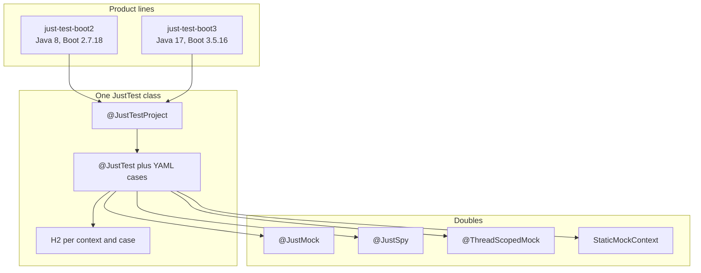
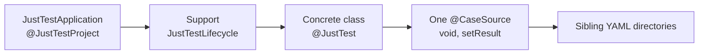
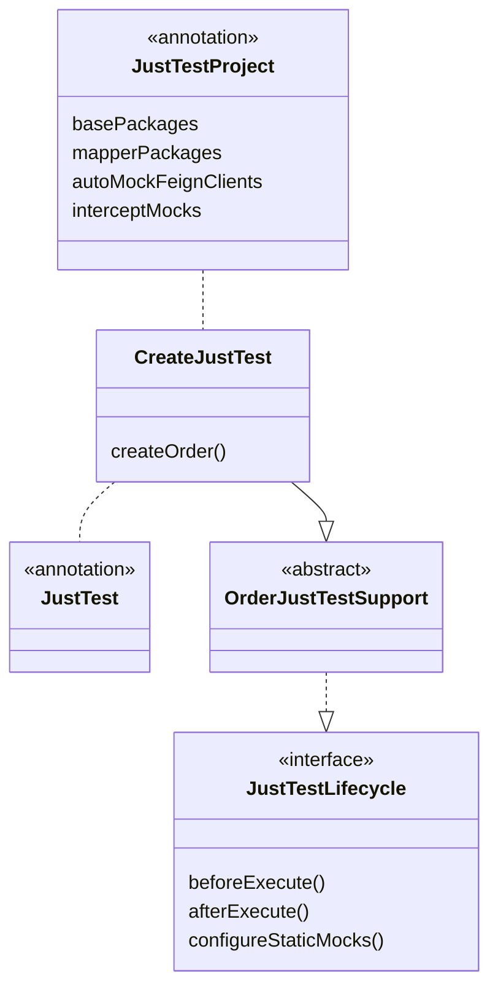
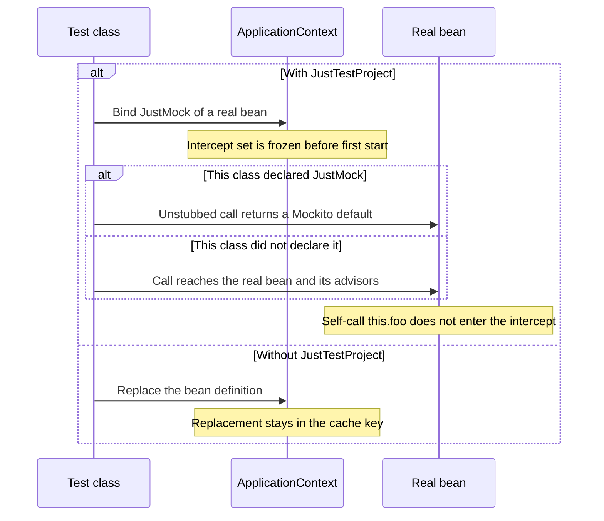
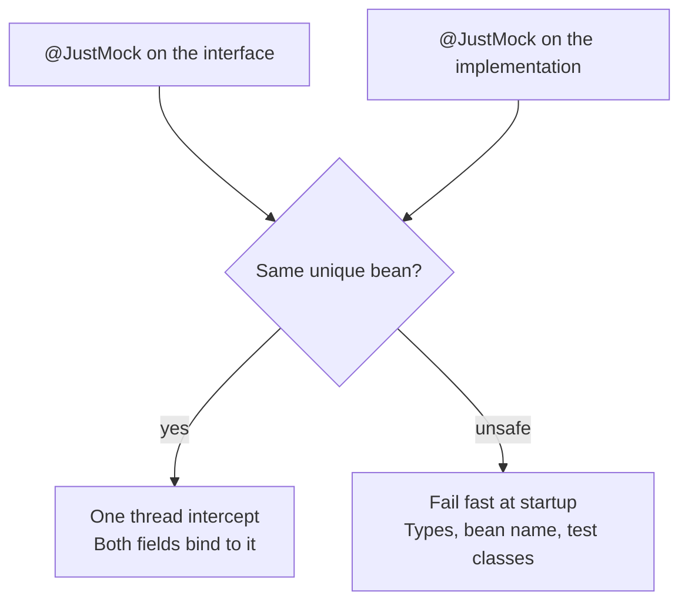
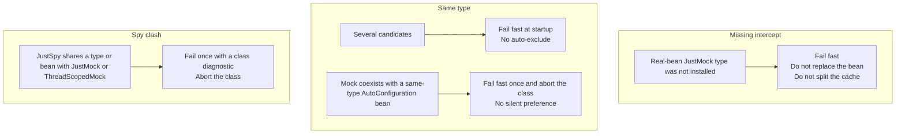
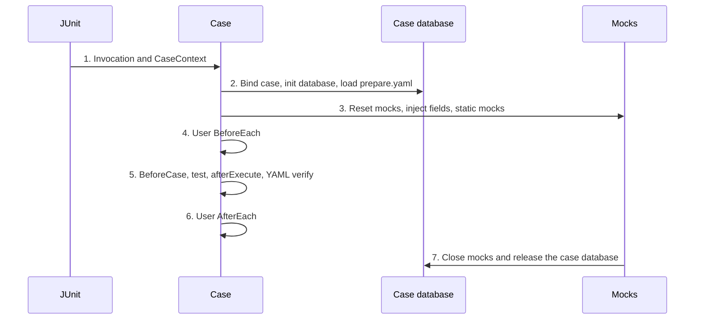
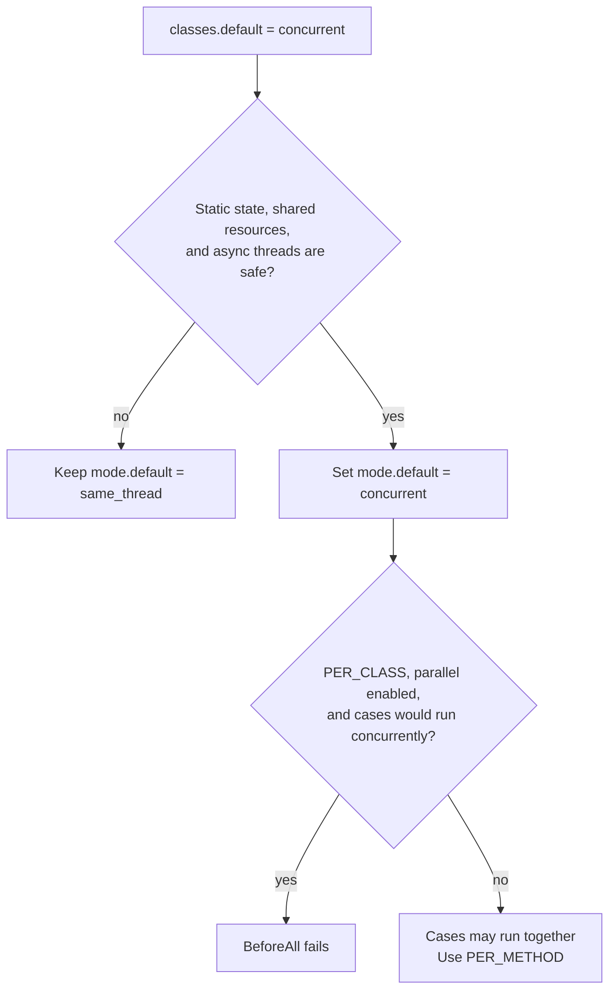

# just-test

[中文文档](README.zh-CN.md)

Reusable Java test toolkit under the [Apache License 2.0](LICENSE).

- Two product lines, one public API: Spring Boot 2 and Spring Boot 3 share `com.just.test` and the same core semantics.
- Test scope only: repeatable setup, assertions, and test doubles.
- It does not replace application design, production database compatibility testing, or concurrency control in application code.

Adopt in this order: [coordinates](#coordinates), [write a test](#write-a-test), then [rules](#rules) when a startup or mock does not match the sample.

<a id="coordinates"></a>

## Coordinates

Maven Central group is `io.github.cyaquarius`. The current released version is `1.2.9`.

| | Boot 2 | Boot 3 |
| --- | --- | --- |
| `artifactId` | `just-test-boot2` | `just-test-boot3` |
| Java / Spring Boot | 8 / 2.7.18 | 17 / 3.5.16 |
| Java package | `com.just.test` | `com.just.test` |
| Released version | `1.2.9` | `1.2.9` |
| Upcoming / local install | `1.2.10` | `1.2.10` |

Java 8 / Boot 2:

```xml
<dependency>
    <groupId>io.github.cyaquarius</groupId>
    <artifactId>just-test-boot2</artifactId>
    <version>1.2.9</version>
    <scope>test</scope>
</dependency>
```

- Java 17 / Boot 3: use `just-test-boot3`. Do not depend on both top-level artifacts.
- Do not declare `just-test-core`. It is shaded into the boot JAR and has no Central coordinate of its own.
- Central publishes only `just-test-boot2` and `just-test-boot3`.
- A repository that already proxies Central only needs the dependency above.
- Without Central access, proxy Central, or upload the boot2 / boot3 artifacts to a private release repository and keep group `io.github.cyaquarius`.
- `mvn install` from this repository is for local development and installs upcoming `1.2.10`. Release history: [changelog](#changelog). Library baseline: [compatibility](#compatibility).

<a id="capabilities"></a>

## Capabilities



- [`@JustTest`](#justtest) runs the Boot test class on framework H2, JDBC, and transactions.
- [`@JustTestProject`](#justtestproject) is the consumer startup annotation.
- [`@CaseSource`](#casesource) turns each YAML case into one JUnit invocation. Files: `prepare.yaml`, `response.yaml`, `expect.yaml`, `expect_exception.yaml`.
- [`@JustMock`](#justmock), [`@JustSpy`](#justspy), and [`@ThreadScopedMock`](#threadscoped) are thread-scoped doubles.
- [`StaticMockContext`](#static-mocks) replaces a static context or factory for one case thread.
- [H2](#h2) isolates each case database. [SQL rewrite](#sql-rewrite) is a narrow MySQL-to-H2 bridge for MyBatis.

<a id="write-a-test"></a>

## Write a test

AI-authored cases: [docs/ai-justtest-authoring.md](docs/ai-justtest-authoring.md). Adopters can copy [docs/skills/just-test/SKILL.md](docs/skills/just-test/SKILL.md) to their own project's `.cursor/skills/just-test/SKILL.md` (or the equivalent agent skill directory).





<a id="startup-class"></a>

### Startup class

```java
// src/test/java/com/example/justtest/JustTestApplication.java
@JustTestProject(
    basePackages = "com.example",
    mapperPackages = "com.example.mapper", // optional; omit if the project has no MyBatis
    dataSourceAliases = "masterDataSource", // optional legacy bean names
    transactionManagerAliases = "masterDataTransactionManager"
    // autoMockFeignClients = true // opt-in thread-scoped mocks for @FeignClient only
    // autoMockFeignClientExcludes = { BillingClient.class }
)
public class JustTestApplication {
}
```

- `JustTestApplication` is the consumer startup configuration for JustTest. It needs no `main` method. The class body can stay empty.
- Put it in a dedicated test package. Put every JustTest class in that package or a child package, for example `com.example.justtest.order`.
- Spring Boot finds this nearer test configuration before the parent package that holds the production `Application`.
- Placing the class only under `src/test` does not prevent a clash: the test classpath contains production classes and test classes.
- Keep ordinary JUnit tests that are not JustTest outside that tree.
- A hand-written `@SpringBootConfiguration` + `@EnableAutoConfiguration` + `@ComponentScan` startup class still works. Prefer `@JustTestProject` for new projects.
- Scan excludes, OkHttp, Feign auto-mock, aliases, and intercept membership: [`@JustTestProject`](#justtestproject) and [`@JustMock`](#justmock).

<a id="test-class"></a>

### Test class and case method

```java
// src/test/java/com/example/justtest/order/OrderJustTestSupport.java
abstract class OrderJustTestSupport implements JustTestLifecycle {

    @Autowired
    protected OrderService orderService;

    @JustMock
    protected PricingClient pricingClient;
}

// src/test/java/com/example/justtest/order/create/CreateJustTest.java
@JustTest
class CreateJustTest extends OrderJustTestSupport {

    @CaseSource
    void createOrder(CaseContext context) {
        context.setResult(orderService.create(context.getLong("customerId")));
    }
}
```

- JustTest does not collect the `@CaseSource` method's Java return value. The method is `void`.
- Call `context.setResult(...)` when `response.yaml` or `verifyResult` should see a result. Omitting it asserts against `null`.
- `@JustTest` already includes the Spring Boot bootstrapper and loads `application-test.yml` through the `test` profile.
- Do not combine `@JustTest` with `@SpringBootTest` or another `@BootstrapWith`.
- The dedicated test package should expose exactly one `@SpringBootConfiguration`.
- Use `@ContextConfiguration(classes = JustTestApplication.class)` only when a test is outside that package hierarchy, several startup configurations are candidates, or that test needs a special configuration.
- Use `@JustMock(name = "beanName")` or `@Qualifier("beanName")` when a type has multiple candidates. Candidate rules: [`@JustMock`](#justmock).
- Prefer `@JustMock` when replacing Spring beans. `@MockBean` is not required.
- Do not use `ReflectionTestUtils` to replace an `@JustMock` `ThreadScope` proxy with a raw Mockito mock in a business bean field. Stub only the test-class `@JustMock` field. Detail: [antipatterns](#antipatterns).
- Use `@JustSpy` when only some methods should be stubbed and the rest must hit the real bean, including `prepare.yaml`. Stubbing, self-invocation, and AOP: [`@JustSpy`](#justspy).

<a id="static-gateways"></a>

### Static gateways

Bind a static Spring gateway per case:

```java
@Override
public void configureStaticMocks(CaseContext context, StaticMockContext mocks) {
    MockedStatic<SpringContextHolder> holder = mocks.mockStatic(SpringContextHolder.class);
    holder.when(SpringContextHolder::getApplicationContext)
          .thenReturn(mocks.getApplicationContext());
}
```

- Unstubbed static methods keep calling the real implementation.
- Do not close the returned `MockedStatic`. JustTest closes every registration after user `@AfterEach`, on the original case thread.
- Boot 2 uses Mockito 4. Static mocks and final-type mocks need the inline mock maker: put `mock-maker-inline` in `src/test/resources/mockito-extensions/org.mockito.plugins.MockMaker`, or add the matching `mockito-inline`.
- Boot 3 uses Mockito 5. Its default mock maker is inline. A consumer that overrides MockMaker still owns static and final mock support.
- JustTest does not select a MockMaker globally.

<a id="case-directories"></a>

### Case directories

- The default case root is the test class package. Case directories are siblings of the `.java` file on the classpath: `{packagePath}/*/*.yaml|yml`.
- JustTest does not probe `{packagePath}/{SimpleClassName}/`.
- A package may contain at most one concrete class that **directly** declares `@JustTest`. Inheriting the marker from a parent is not enough.
- Abstract Support bases belong in the parent business-class directory. They hold shared lifecycle and mocks only. They must not be `@JustTest`, and they must not own case YAML. Annotating an abstract Support fails fast.
- Put one `@CaseSource` method on the concrete class. Several `@CaseSource` methods on the same class share every sibling case.
- The case layout stays Support + method packages. Do not invent a second case-root convention.
- `@CaseSource("custom-root")` resolves to `{packagePath}/{custom-root}/`. A missing package root or custom root fails with `No YAML case directories found` and names the expected sibling layout. There is no silent fallback to a class-named directory or any other root.

```text
src/test/java/com/example/justtest/order/
├── OrderJustTestSupport.java
├── create/
│   ├── CreateJustTest.java
│   ├── ok/
│   ├── dup/
│   └── bad-input/
└── cancel/
    ├── CancelJustTest.java
    └── ok/
```

Each case directory may include `request.yaml`, `prepare.yaml`, `response.yaml`, `expect.yaml`, and `expect_exception.yaml` as needed. The same stage also accepts `.yml`. If both suffixes exist for one stage, JustTest fails fast and names both paths. Duplicate keys in a case file fail at parse time.

Map those YAML files onto the test classpath:

```xml
<testResources>
    <testResource>
        <directory>src/test/java</directory>
        <includes>
            <include>**/*.yaml</include>
            <include>**/*.yml</include>
        </includes>
    </testResource>
    <testResource>
        <directory>src/test/resources</directory>
    </testResource>
</testResources>
```

- Keep `src/test/resources` for `schema.sql` and `application-test.yml`.
- YAML may also live under `src/test/resources` at the same package path. The discovery path does not change.
- Flag meanings: [YAML files and flags](#yaml).

<a id="rules"></a>

## Rules

<a id="justtest"></a>

### `@JustTest`

- Configures Spring Test, H2, `JdbcTemplate`, and a transaction manager so application services can exercise their normal transaction behavior.
- Registers a `refresh` scope stand-in when none exists, so beans that use `@RefreshScope` or `@Scope("refresh")` load without Spring Cloud refresh infrastructure.
- Tests do not get real refresh semantics.
- Class-level execution contract: [lifecycle](#lifecycle).

<a id="justtestproject"></a>

### `@JustTestProject`

Recommended consumer startup annotation. An empty class is enough.

- `@JustTestProject` meta-annotates `@SpringBootConfiguration` and `@EnableAutoConfiguration`.

**Framework-owned**

- H2, the transaction manager, and `JdbcTemplate`.
- The default component-scan denylist. `FeignAutoConfiguration` and `FeignContext` are not excluded.
- When `mapperPackages` is set: MyBatis `SqlSessionFactory`, `SqlSessionTemplate`, and MapperScan, bound to JustTest's DataSource.
- The framework does not choose a Feign HTTP client.
- The framework does not auto-mock Redis, object storage, SDKs, or other non-Feign beans.

**Defaults you may overlay**

- `excludeClasses`, `excludeFilters`, `includeFilters`, `excludeAutoConfiguration`, `autoMockFeignClients`, and `autoMockFeignClientExcludes`.
- You do not need to copy the default denylist.
- `enableFeignOkHttp` is a deprecated no-op kept for source compatibility.

**The project must declare**

- `basePackages`. JustTest does not guess a business root.
- `src/test/resources/sql/schema.sql`.
- Explicit `@JustMock` or `@ThreadScopedMock` for non-Feign external dependencies.
- Do not put production DataSource or transaction-manager configuration on the test startup class.

**Scan excludes**

- Other `@SpringBootApplication` / `@SpringBootConfiguration` types under `basePackages`.
- `@Controller`, `@RestController`, and `@ControllerAdvice`, when those annotations exist.
- `@FeignClient`, when OpenFeign is present.
- Known job and scheduling stereotypes, when they can be detected without a hard dependency.

**Transport and Feign**

- OkHttp / Feign transport stays a project setting. JustTest does not write `feign.okhttp.enabled` or `spring.cloud.openfeign.okhttp.enabled`, including the value `false`.
- If `OkHttpFeignConfiguration` registers a bean named `client` that collides with `@Resource private XxxClient client`, disable OkHttp in the project, or rename the field, or use `@Resource(name = ...)`.
- `FeignAutoConfiguration` and `FeignContext` stay enabled.
- `autoMockFeignClients` defaults to `false`.
- When it is `true`, JustTest discovers interfaces annotated with `@FeignClient` (annotation presence only; no `*Client` name heuristic) and registers the same thread-scoped Mockito mocks as `@JustMock`.
- Explicit `@JustMock`, `@JustSpy`, and `@ThreadScopedMock` replace those auto mocks for the same type. `@JustSpy` wraps the existing bean instead of replacing it with a pure mock.
- `autoMockFeignClientExcludes` skips selected Feign types.
- Redis, OSS, SDKs, and other clients stay explicit mocks on Support or MockConfig.

**Aliases and MyBatis**

- `dataSource` and `transactionManager` are registered as aliases of the JustTest primaries when those names are free.
- Extra names in `dataSourceAliases` / `transactionManagerAliases` are registered the same way for legacy `@Qualifier` / `@Transactional` values.
- Blank alias entries are ignored. Duplicates are discarded.
- A name that already exists as a bean definition or alias is left unchanged. JustTest logs the skip.
- `mapperPackages` without mybatis-spring fails fast.
- mybatis-spring without `mapperPackages` does not invent a scan root.

**Moving an existing startup class**

- A hand-written startup class still works.
- Migrating a narrow hand-written startup class to `@JustTestProject` widens component scan and Boot auto-configuration. Move the project's `excludeAutoConfiguration` and mock declarations with that wider surface.
- JustTest will not auto-exclude third-party `*AutoConfiguration` classes to make a mock win. Conflict behavior: [`@ThreadScopedMock` and auto-configuration](#threadscoped).

<a id="casesource"></a>

### `@CaseSource`

- Discovers YAML cases and creates one full JUnit test-template invocation per case.
- `CaseContext` is available to the test and to standard per-test lifecycle methods.
- `@CaseSource` is itself the test annotation. Do not combine it with another JUnit test annotation.
- Directory rules: [case directories](#case-directories). Step order: [lifecycle](#lifecycle).

<a id="justmock"></a>

### `@JustMock`



**Thread-scoped mock**

- `@JustMock` creates a thread-scoped Mockito mock.
- Spring auto-proxy leaves that per-thread instance unwrapped, so the injected field stays a Mockito mock when the concrete class would otherwise be advised, such as a `@Repository` implementation.

**Choosing a bean**

- When several beans share a type, an explicit `name` wins only for a type-compatible bean.
- If an existing bean's type cannot be resolved (for example, a `FactoryBean` hides its object type), name fallback still applies.
- A same-named bean of an unrelated type is not replaced.
- A wrong explicit name fails with a missing-candidate error.
- Multiple candidates of the same type still fail fast at startup.
- JustTest does not auto-exclude `*AutoConfiguration`.

**Bind an existing thread-scoped mock**

- If the resolved target is already a thread-scoped mock from a `@ThreadScopedMock` `@Bean`, or from `@JustTestProject(autoMockFeignClients = true)`, the field only binds to that mock.
- JustTest does not register another bean definition.
- That declaration is not part of the Spring Test context cache key.
- Classes that bind different subsets of those existing mocks share one `ApplicationContext`.
- Injection unwraps the scoped proxy, so `when(field...)` and `doReturn(...).when(field)` stub the field directly.
- Per-case reset is unchanged.

**Real bean, with `@JustTestProject`**

- `@JustMock` of a real bean is also a bind.
- The real bean is hidden at startup. Its advisors stay on it.
- The public bean is a thread-scoped Mockito mock whose default answer switches per thread.
- If this test class declared `@JustMock` for that type, unstubbed calls return Mockito defaults. Otherwise the call goes to the real bean.
- Activation follows the declaration, not whether any stub is registered.
- Stubs reset at case end.
- The declaration does not enter the context cache key, so different real-bean subsets share one context.
- The intercept set is fixed before the first start of that shared context and cannot grow afterward.
- The set is `interceptMocks` on that `@JustTestProject`, plus real-bean `@JustMock` types on `@JustTest` classes in that startup class's package and subpackages whose resolved startup class is that same `@JustTestProject` class.
- A test outside that package tree that needs intercept must list the types in `interceptMocks`.
- A later `@JustMock` of a type that was not installed fails fast. JustTest does not replace the bean and does not split the cache.
- A call the real bean makes to itself (`this.foo()`) does not enter the intercept.

**Same bean, interface and implementation (`1.2.8`)**



- `1.2.7` still intercepts a real bean and still shares one context. Registration in that release is per declaration type.
- `1.2.8` registers one thread intercept per resolved bean name.
- An interface declaration and an implementation declaration that resolve to that same unique bean share the intercept. Both `@JustMock` fields bind to it.
- Declaring either type activates Mockito defaults for the current test class. A class that declared neither still calls the real bean.
- A second declaration that cannot be merged (incompatible mock type, or more than one matching bean) fails at context startup.
- That failure names the declaration types, the bean name, and the test classes that declared them.
- A mixed interface / implementation pair that resolves to the same bean stays valid. JustTest does not require those declarations to be rewritten.

**Real bean, without `@JustTestProject`**

- A real bean is still replaced.
- That replacement still participates in the cache key.



- Any matching check fails startup. The figure groups the checks; it is not an execution order. Diagnostics for the auto-configuration case: [`@ThreadScopedMock` and auto-configuration](#threadscoped).

<a id="justspy"></a>

### `@JustSpy`

- Partially stubs an existing bean. Unstubbed methods run that real bean, including `prepare.yaml` / H2 data.
- Bean selection uses the same `name` / `@Qualifier` / candidate rules as `@JustMock`.
- If no bean exists, startup fails. JustTest never creates one.
- The real bean stays a hidden singleton. It is not a second injectable bean of that type.
- The original name becomes a thread-scoped scoped proxy. Each thread's instance is `mock(type, withSettings().defaultAnswer(delegatesTo(realBean)))`.
- That covers MyBatis `MapperFactoryBean` and Feign-style JDK proxies without `Mockito.spy`.
- The delegate is the container bean as Spring exposes it.
- When that bean is an AOP proxy such as `@Transactional`, unstubbed calls go through the proxy and its advisors, not the unwrapped target.
- Spring auto-proxy leaves the thread-scoped mock unwrapped, so `@Repository` exception translation and `@Transactional` stay on the real bean.
- `doReturn` / `doThrow` apply directly to the injected field.
- Stub with `doReturn`, `doThrow`, or `doNothing`. `when(spy.foo())` invokes the real method.
- Self-invocation inside the real bean (`this.bar()`) is not intercepted.
- An explicit `@JustSpy` wins over `autoMockFeignClients` for that type.
- The same field cannot carry both `@JustMock` and `@JustSpy`.
- The same type, or the same resolved bean, cannot also be `@JustMock` or `@ThreadScopedMock`. Startup fails once with a class-level diagnostic (type, candidates, sources), and JUnit aborts the class.
- `@JustSpy` stays in the Spring Test context cache key. It is unchanged by the real-bean `@JustMock` intercept.
- Each case reset builds a new delegating mock, so stubs do not leak.

<a id="threadscoped"></a>

### `@ThreadScopedMock` and auto-configuration

- `@ThreadScopedMock` applies the same scoped-mock model to an annotated `@Bean` method.
- If a `@JustMock` or `@ThreadScopedMock` bean still coexists with a same-type bean from an `*AutoConfiguration`, JustTest fails fast once at context startup.
- The diagnostic names the conflicting type, candidate names, mock versus auto-configuration origin, and the next step: `excludeAutoConfiguration` or remove the extra mock.
- JustTest does not auto-exclude auto-configurations, does not silently prefer the mock, and does not change `@Resource` matching.
- JUnit aborts the test class, so YAML `@CaseSource` cases do not each rebuild the same failed context.

<a id="static-mocks"></a>

### `StaticMockContext`

- Can replace an application static context or factory gateway on the current case thread, and restores it at case end.
- Active window, async threads, and legacy tests: [boundaries](#boundaries).

<a id="h2"></a>

### H2

- The JustTest context uses the H2 `DataSource`, transaction manager, and `JdbcTemplate` supplied by the framework.
- Exclude remaining production persistence configuration with the `test` profile or with `excludeClasses` / `excludeFilters`.
- The framework does not rewrite user bean `@Primary` metadata.
- The framework does not choose between production and test data sources on the consumer's behalf.
- The H2 database is isolated per JustTest `ApplicationContext` and active case.
- Cleaned DDL is cached. The schema is cloned from a template database by default. Disable cloning with `justtest.schema.clone=false`.
- Each case database is released at case end. Schema initialization is retried after failure.
- For MySQL `schema.sql` dumps, the cleaner strips common `SHOW CREATE TABLE` extras: table `ROW_FORMAT`, `UNSIGNED`, `ON UPDATE CURRENT_TIMESTAMP`, column `CHARACTER SET`, and `DEFAULT b'0'`. Text inside strings, comments, and backtick identifiers is left unchanged.
- The cleaner does not cover every MySQL dialect.
- A missing framework `JdbcTemplate` or `JustTestRoutingDataSource`, when `@JustTest` owns H2, is a configuration error and fails fast. It does not skip prepare or verify. See [boundaries](#boundaries).

<a id="sql-rewrite"></a>

### MySQL-to-H2 rewrites

- MyBatis test SQL gets a narrow rewrite: `IF(...)` becomes `CASEWHEN(...)`, and `DATE_FORMAT(...)` becomes `FORMATDATETIME(...)`.
- The `DATE_FORMAT` rewrite runs through the MyBatis `StatementHandler` interceptor, the same path as `IF(...)` to `CASEWHEN(...)`.
- Plain `JdbcTemplate` SQL is not rewritten unless it goes through that interceptor.
- Legacy double-quoted string literals are supported inside known string functions and on the right side of comparison operators.
- New SQL should use standard single-quoted strings. That limit is also stated under [boundaries](#boundaries).

<a id="yaml"></a>

## YAML files and flags

- `request.yaml`: input exposed through `CaseContext` (`getString`, `getLong`, `getInt`, `getObject`, `getList`, and `getMap`).
- `prepare.yaml`: rows inserted before the case.
- `response.yaml`: expected return value. Compared only to the object written with `CaseContext.setResult`, not the test method's Java return value.
- `expect.yaml`: expected database rows.
- `expect_exception.yaml`: expected exception type and optional message. A file that is present but empty or missing `type` is a configuration error and does not accept an arbitrary exception.

Field suffix flags are stage-specific:

- `[C]` selects rows in `expect.yaml` and enables unordered List matching in `response.yaml`.
- Once any List item uses `[C]`, every expected item must be an object with at least one `[C]` field.
- JustTest rejects unordered expectations that mix keyed and unkeyed items.
- `[CN]` applies only to `expect.yaml`.
- `[F]` applies only to `prepare.yaml`.
- The remaining flags apply to the preparation or assertion stage in the table.

| Flag | Meaning |
| --- | --- |
| `[C]` | Row selection key; also enables unordered list matching. |
| `[CN]` | Selected row must not exist. |
| `[N]` | Skip the field; in `prepare.yaml`, do not insert it. |
| `[R]` | Regular-expression match. |
| `[A]` | Non-null assertion. |
| `[D]` / `[D60]` | Actual time is within N seconds of *now* (default 60). The YAML expected value is not compared. |
| `[J]` | JSON structural comparison. |
| `[F]` | Raw database function in `prepare.yaml`, such as `NOW()`. |

Flags are case-sensitive. An unknown flag such as `[cn]` or `[CC]`, or a flag used outside its stage, fails immediately. The error names the field, the case path, and the flags legal for that stage.

For database expectations, prefer explicit `[C]` fields so the intended row is unambiguous. A `[C]` condition that matches more than one row fails until it is tightened to one row. `[J]` compares JSON structure; numeric values match as BigDecimal, so `1` and `1.0` are equal, and JSON that cannot be parsed is an error.

<a id="lifecycle"></a>

## Lifecycle



- `@JustTest` is a class-level execution contract: the test class must implement `JustTestLifecycle`, and every executable test method in the class must use `@CaseSource`.
- If the class does not implement the interface, or it contains `@Test`, `@RepeatedTest`, `@ParameterizedTest`, `@TestFactory`, or another ordinary JUnit test method, JustTest fails in `BeforeAll` and asks you to fix the class.
- Combining `@TestInstance(PER_CLASS)` with concurrent case execution (only when `junit.jupiter.execution.parallel.enabled=true`) also fails in `BeforeAll`. See [parallel execution](#parallel).
- For incremental adoption, leave existing JUnit test classes unchanged and put new cases in a separate `@JustTest` class. Legacy classes without `@JustTest` are unaffected.
- `@CaseSource` is itself the test annotation. Do not combine it with another JUnit test annotation.

For every YAML case JustTest performs:

1. create an independent JUnit invocation and its `CaseContext`;
2. bind the case, create and initialize a fresh case database, and load `prepare.yaml`;
3. reset and prewarm scoped mocks, inject `@JustMock` / `@JustSpy` fields, and configure case static mocks;
4. execute user `@BeforeEach` methods;
5. invoke matching `@BeforeCase("case-name")` methods and `beforeExecute`, execute the test, always call `afterExecute` (even if the test threw), then verify exception, result, and database data. If `afterExecute` itself throws, YAML verification is skipped and that exception is propagated (the original test exception is added as suppressed when present). An exception that is not declared in `expect_exception.yaml` and not handled by `verifyException` is rethrown after `afterExecute` and YAML verification;
6. execute user `@AfterEach` methods;
7. close static and scoped mocks and release the case database, retaining cleanup failures without hiding the original test failure.

<a id="compatibility"></a>

## Compatibility

| Component | `just-test-boot2` | `just-test-boot3` |
| --- | --- | --- |
| Java | 8 | 17 |
| Spring Boot | 2.7.18 | 3.5.16 |
| Spring Framework | 5.3.31 | 6.2.19 |
| JUnit Jupiter | 5.14.4 | 5.12.2 |
| Mockito | 4.11.0 | 5.17.0 |
| MyBatis / mybatis-spring | 3.5.19 / 2.1.2 | 3.5.19 / 3.0.6 |
| H2 | 2.1.214 | 2.3.232 |
| SnakeYAML | 1.33 | 2.4 |
| fastjson2 | 2.0.64 | 2.0.64 |
| SLF4J | 1.7.36 | 2.0.18 |

- The Boot 2 line retains the final 2.7.18 release and a real Java 8 baseline.
- The Boot 3 line uses stable Boot 3.5.16 on Java 17 and does not move to Boot 4.
- Versions come from the corresponding Spring Boot BOM except for MyBatis, mybatis-spring, fastjson2, Boot 2 Mockito / SnakeYAML, the Boot 2 `junit-bom` override (JUnit Jupiter 5.14.4), and build plugins.
- Builds use Maven Compiler Plugin 3.15.0 and Surefire 3.5.6.
- CI uses `actions/checkout@v7` and `actions/setup-java@v6`.
- The matrix is the standalone build and validation baseline for both product lines.
- CI also runs consumer smoke tests under the matching Spring Boot parent / BOM to cover a common application layout.

<a id="boundaries"></a>

## Boundaries and concurrency

JustTest isolates the test resources it owns. It does **not** make arbitrary application code globally parallel-safe.

- Static registries initialized by application code remain an application concern.
- Case static mocks affect only the current thread. They are active for user `@BeforeEach`, the test, and user `@AfterEach`; they cannot cover Spring context refresh or Spring Test listeners that run before the case invocation, and do not propagate to application-created asynchronous threads.
- When multiple Spring contexts are detected, JustTest emits one risk warning. A related case failure adds a diagnostic log without replacing the original exception. The presence of an arbitrary static mock does not suppress this hint because the framework cannot know whether it covers the relevant gateway.
- New and legacy test classes can coexist; legacy classes without `@JustTest` do not activate the JustTest lifecycle. If both run in parallel while application code shares a JVM-static ContextHolder or factory, JustTest cannot protect the legacy test thread. Keep affected legacy tests serial or migrate their static gateway.
- Manually created threads, `CompletableFuture` common-pool tasks, and executors not managed by JustTest do not receive mock or database context automatically; database or thread-scoped mock access without an active case fails fast instead of creating an empty H2 database or an unstubbed mock. When `@JustTest` owns H2 infrastructure, a missing framework `JdbcTemplate` or `JustTestRoutingDataSource` is also a configuration error and fails fast rather than skipping prepare/verify.
- Spring `@Transactional` and `@Sql` are unsupported on a JustTest class or `@CaseSource` method because their lifecycle runs before a case is bound; JustTest fails fast on these configurations. Use `prepare.yaml` and `expect.yaml` for deterministic case data instead.
- A passing rerun is not proof of concurrency safety. Keep flaky suites serial until their ownership and lifecycle boundaries are established.
- Write new SQL with standard single-quoted strings. The double-quote rewrite is only a compatibility bridge for existing MySQL mapper SQL.

<a id="parallel"></a>

### Parallel execution

The consumer project's JUnit configuration controls scheduling. JustTest isolates framework-owned resources once tests run in parallel.



Start with classes concurrent and cases inside each class sequential:

```properties
# src/test/resources/junit-platform.properties
junit.jupiter.execution.parallel.enabled=true
junit.jupiter.execution.parallel.mode.default=same_thread
junit.jupiter.execution.parallel.mode.classes.default=concurrent
```

- After verifying that application static state, external shared resources, and asynchronous threads are safe, set `mode.default` to `concurrent` to run cases within the same class concurrently.
- Normal tests do not need `@Execution`. Use `@Execution(ExecutionMode.SAME_THREAD)` only to downgrade an exceptional class that cannot satisfy the concurrency boundaries.
- `@TestInstance(PER_CLASS)` cannot be combined with concurrent case execution when JUnit parallel is enabled (`junit.jupiter.execution.parallel.enabled=true`) and cases would run concurrently (`@Execution(CONCURRENT)` or `mode.default=concurrent`).
- Those cases would share one test instance and can race `@JustMock` field injection.
- If parallel is disabled, leftover `@Execution` or `mode.default=concurrent` settings are ignored for this check.
- Use the JUnit default `PER_METHOD` with concurrent cases, or keep `PER_CLASS` with `SAME_THREAD`.
- Class-level parallelism (`mode.classes.default`) is not case concurrency.
- An overlap or barrier contract that needs N parties also needs N free workers from the same pool.
- This repository's contract tests pin that pool at 2 in `src/contract-test/resources/junit-platform.properties` (`junit.jupiter.execution.parallel.config.strategy=fixed`, `junit.jupiter.execution.parallel.config.fixed.parallelism=2`).
- A 2-party barrier holds one worker until the other party enters. If those parties share the default suite's pool with other concurrent classes, one worker can stay inside another class, the missing party is never scheduled, and the barrier times out.
- That timeout is JUnit scheduling on a saturated fixed pool. JustTest isolation is unchanged: consumers may still run test classes concurrently and, after the safety check above, cases within a class.
- The Surefire split only reserves both workers for the barrier.
- In this repository, `just-test-boot2` and `just-test-boot3` keep that properties file for every Surefire execution.
- `ConcurrentCasesJustTest` (in-class case overlap) runs in `concurrent-case-contract`.
- `ParallelFirstJustTest` and `ParallelSecondJustTest` (class-level overlap) run in `parallel-class-contract`.
- The `default-test` execution still runs the other contract classes concurrently.
- Leave the overlap classes in those executions. Moving them back into `default-test`, serializing their cases, weakening the overlap assertions, or only raising the barrier timeout leaves the same stall in place.

<a id="antipatterns"></a>

### Parallel rollout antipatterns

A parallel failure is not automatically a JustTest isolation failure; first inspect the downstream project's test doubles, static state, and resource lifecycle. The following patterns can make usage errors look like framework flakes:

1. **Replacing an `@JustMock` proxy with `ReflectionTestUtils`**
   - **Wrong:** In `beforeExecute`, use `ReflectionTestUtils` to write a raw Mockito mock into a business bean field, replacing the `ThreadScope` proxy created by `@JustMock`. Business beans are often singletons, so this pollutes a singleton field and lets other threads or cases see the wrong stub.
   - **Right:** Stub only the test-class `@JustMock` field and keep business beans wired to the scoped proxy. Use `StaticMockContext` / `configureStaticMocks` to configure static factory or context gateways per case.

2. **Adding a keep-alive flag to the case H2 URL**
   - **Wrong:** Add `DB_CLOSE_DELAY=-1` (or a similar keep-alive flag) to the case URL to hide `already closed`. This only defers the lifecycle problem and can cause memory growth, slower full runs, or OOM.
   - **Right:** Follow the resource boundary described in [#12 (`already closed`)](https://github.com/cyAquarius/just-test/issues/12): when switching cases, unbind thread-bound JDBC/MyBatis holders first, then release the old `DataSource` and rebuild the current case `DataSource`. The template database may use `DB_CLOSE_DELAY=-1` internally for schema cloning (see [#16](https://github.com/cyAquarius/just-test/issues/16)); that is not permission to add it to case URLs. The default case URL contains no `DB_CLOSE_DELAY`.

3. **Expecting JustTest to repair application static registries**
   - **Wrong:** Blame JustTest for concurrency pollution in an application static context, factory, or registry, expect the framework to repair it automatically, or default to adding a global `ContextCreationLock` upstream. JustTest does not own the isolation or concurrency governance of those application static gateways.
   - **Right:** Use this rollout checklist:
     - Multiple Spring Context warning → check whether `StaticMockContext` / `configureStaticMocks` covers the relevant static context or factory gateway.
     - Diagnose Bean wiring issues such as the Mapper `#0` dual-bean case by name, qualifier, and startup configuration; see [#11](https://github.com/cyAquarius/just-test/issues/11) instead of hiding them with a global lock.
     - Tests that cannot be isolated stay serial: use `@Execution(ExecutionMode.SAME_THREAD)` or run the test class serially.
     - Do not default to adding a global `ContextCreationLock` upstream; fix the static gateway isolation first, and keep unisolated tests serial.

4. **Unstubbed external dependencies plus business fail-open**
   - **Wrong:** Leave critical external dependencies unstubbed while business code swallows an exception or treats it as success; parallel timing and return values can make this look like a framework flake.
   - **Right:** Stub critical collaborators in `beforeExecute` / `@BeforeCase` and assert success and exception paths explicitly; do not pass undefined external return values into business fail-open logic.

<a id="changelog"></a>

## Changelog

The current Maven Central release is `1.2.9`. The rules above match that release.

- **1.2.10 (upcoming)** — static `@JustMock` and `@JustSpy` fields fail fast in `BeforeAll`. The error names the field and says that static mock and spy fields break thread isolation, because concurrent cases would write the same field and clobber stubs. Instance fields are unchanged. [Issue #105](https://github.com/cyAquarius/just-test/issues/105).
- **1.2.10 (upcoming)** — Boot 2 fails fast when `@JustMock` replacement, `@JustSpy`, or a real-bean intercept mocks a concrete class that declares a public or protected final instance method, including methods on superclasses other than `java.lang.Object`, and the current MockMaker is not inline. The error tells the adopter to add `mockito-extensions/org.mockito.plugins.MockMaker` or the `mockito-inline` dependency. JustTest still does not select a MockMaker. Private, package-private, and static finals do not trigger it, and Boot 3 is unchanged. [Issue #104](https://github.com/cyAquarius/just-test/issues/104).
- **1.2.10 (upcoming)** — `@JustMock` replacement and real-bean intercept keep the bean's aliases. `@Qualifier("alias")` and `@Resource(name = "alias")` still inject the thread-scoped mock. An alias that would clash with an existing bean name or another alias is skipped and logged; the rest of the install continues. [Issue #103](https://github.com/cyAquarius/just-test/issues/103).
- **1.2.10 (upcoming)** — MySQL DDL cleanup leaves strings, comments, and backtick identifiers unchanged. An escaped comment quote (`\'` or `''`) is removed with the `COMMENT` clause instead of leaving a fragment that breaks H2. `COLLATE` still strips column `COLLATE name` and table `COLLATE=name`, and no longer deletes identifiers such as `collate_flag`. [Issue #102](https://github.com/cyAquarius/just-test/issues/102).
- **1.2.10 (upcoming)** — double-quoted literal compatibility includes `CONCAT`. `CONCAT("a","b")` is rewritten to `CONCAT('a','b')`. New SQL should still use single quotes. [Issue #107](https://github.com/cyAquarius/just-test/issues/107).
- **1.2.10 (upcoming)** — `DATE_FORMAT` literal text is quoted for H2 `FORMATDATETIME`, so English text such as `Date: %Y` and `Day %d` keeps its letters. `%M` maps to the month name, `%T` maps to `HH:mm:ss`, and `%%` maps to one `%`. An unknown specifier fails fast and the error includes the original format string. Numeric patterns such as `%Y-%m-%d %H:%i:%s` and CJK literals still format as before. [Issue #101](https://github.com/cyAquarius/just-test/issues/101).
- **1.2.10 (upcoming)** — YAML load and assertion edges fail fast instead of passing silently. Duplicate keys are rejected. An `expect_exception.yaml` that exists but is empty or missing `type` is a configuration error and does not swallow exceptions. An `expect.yaml` `[C]` that matches more than one row fails until `[C]` is tightened. `[J]` compares numbers as BigDecimal (`1` equals `1.0`) and reports JSON parse failures instead of falling back to string comparison. A flag-only `[N]:` inside an object skips that key only. [Issue #113](https://github.com/cyAquarius/just-test/issues/113).
- **1.2.10 (upcoming)** — unknown or wrong-case YAML flags such as `[cn]` and `[CC]` fail fast instead of falling through to exact matching. The error names the field, the case path, and the flags legal for that stage. [Issue #108](https://github.com/cyAquarius/just-test/issues/108).
- **1.2.10 (upcoming)** — load `.yml` case stage files that discovery already accepts. A directory that only has `.yml` fixtures applies prepare data and assertions. The same stage with both `.yaml` and `.yml` fails fast. [Issue #100](https://github.com/cyAquarius/just-test/issues/100).

- **1.2.9** — recognize MapperFactoryBean product metadata when installing thread intercepts without initializing unrelated FactoryBeans. [Issue #97](https://github.com/cyAquarius/just-test/issues/97).

- **1.2.8** — one thread intercept per resolved bean name. [Issue #93](https://github.com/cyAquarius/just-test/issues/93).
  - An interface `@JustMock` and an implementation `@JustMock` that resolve to the same unique bean register once. Both fields bind to that thread-scoped mock.
  - Declaring either type activates Mockito defaults. A test class that declared neither still calls the real bean.
  - A declaration that cannot be merged (incompatible mock type, ambiguous beans) fails at context startup.
  - The failure lists the declaration types, the bean name, and the test classes that declared them.
  - The `1.2.7` context-sharing intercept stays. This release does not replace it with a fail-fast that rejects every mixed interface / implementation pair.
- **1.2.7** — `@JustMock` of a real bean intercepts that bean instead of replacing it and splitting the Spring Test context. [Issue #88](https://github.com/cyAquarius/just-test/issues/88). Canonical rules: [`@JustMock`](#justmock).
  - Tests that use the same `@JustTestProject` startup class share one `ApplicationContext`.
  - The intercept set is fixed before the first start of that shared context and cannot grow afterward.
  - The set is `@JustTestProject(interceptMocks = ...)` plus real-bean `@JustMock` types from `@JustTest` classes in that startup class's package and subpackages whose resolved startup class is that same `@JustTestProject` class.
  - A test outside that package tree that needs intercept must list the types in `interceptMocks`.
  - On the current thread, a declared `@JustMock` returns Mockito defaults until stubbed.
  - A test class that did not declare `@JustMock` for that type still calls the real bean and its advisors.
  - Stubs reset at case end.
  - These declarations do not register another bean definition and do not enter the context cache key.
  - A `@JustMock` whose type was not installed fails fast. JustTest does not replace the bean and does not split the cache.
  - `@JustSpy` is unchanged and still part of the cache key.
  - Self-invocation (`this.foo()`) inside the real bean does not enter the intercept.
- **1.2.6** — `@JustMock` of an already thread-scoped mock is a bind. [Issue #85](https://github.com/cyAquarius/just-test/issues/85).
  - The target is a `@ThreadScopedMock` `@Bean`, or a Feign client created by `autoMockFeignClients`.
  - The field is injected and unwrapped for stubbing.
  - The bean definition is not registered again, and the declaration does not create a new Spring Test context.
  - `@JustSpy` still changes the context cache key.
- **1.2.5** — thread-scoped `@JustSpy` and `@JustMock` stay stubbable when Spring would otherwise auto-proxy the concrete class (`@Repository`, `@Transactional`). Advisors stay on the real bean. [Issue #81](https://github.com/cyAquarius/just-test/issues/81).
- **1.2.4** — adds `@JustSpy`, so a test can stub some methods of an existing bean while unstubbed methods keep the real bean, including `prepare.yaml` / H2.
- **1.2.3** — unfinished Spring transaction synchronization or thread state fails the case that leaked it.
  - The check runs at every case boundary, including when that case's `expect_exception.yaml` matched.
  - Business code must commit or roll back on every path, or validate before calling `getTransaction`.
  - JustTest quarantines a detected leak so the next case is isolated. That quarantine is not a substitute for business rollback.
  - [Issues #6](https://github.com/cyAquarius/just-test/issues/6) and [#12](https://github.com/cyAquarius/just-test/issues/12) covered MyBatis / JDBC holders. [#67](https://github.com/cyAquarius/just-test/issues/67) additionally covers Spring transaction synchronization and active-transaction thread state.
- **1.2.2** — `@JustMock` / `@ThreadScopedMock` coexisting with a same-type bean from an `*AutoConfiguration` fails fast, with a class-level diagnostic instead of a repeated `NoUniqueBeanDefinitionException` per YAML case. JustTest still does not auto-exclude auto-configurations.
- **1.2.1** — withdrew the framework default OkHttp disable, and added opt-in `@JustTestProject(autoMockFeignClients)` for `@FeignClient` interfaces only.

<a id="public-api"></a>

## Public API

- Stable public API, under `com.just.test`: `annotation` (`@JustTest`, `@JustTestProject`, `@CaseSource`, `@JustMock`, `@JustSpy`, `@BeforeCase`, `@ThreadScopedMock`), `CaseContext`, `JustTestLifecycle`, and `StaticMockContext`.
- `JustTestMarker` and the Boot `JustTestClassValidationExtension` exist so `@JustTest` can register JUnit / Spring infrastructure. Do not depend on them directly.
- Engine types live in `com.just.test.internal`. They are unsupported for consumers even when they remain public for JUnit or Spring registration.
- When moving an application to Boot 3, migrate its Java EE types to Jakarta as required by Spring Boot 3.
- Java SE `javax.sql.DataSource` is not part of that migration.

<a id="build"></a>

## Build and verify

An environment with only Java 8 can verify the Boot 2 line:

```bash
JAVA_HOME=/path/to/jdk8 PATH="$JAVA_HOME/bin:$PATH" \
  mvn --batch-mode --no-transfer-progress -pl just-test-boot2 -am clean install
JAVA_HOME=/path/to/jdk8 PATH="$JAVA_HOME/bin:$PATH" \
  mvn --batch-mode --no-transfer-progress -f smoke-tests/boot2/pom.xml clean test
```

A Java 17 environment can verify the Boot 3 line:

```bash
JAVA_HOME=/path/to/jdk17 PATH="$JAVA_HOME/bin:$PATH" \
  mvn --batch-mode --no-transfer-progress -pl just-test-boot3 -am clean install
JAVA_HOME=/path/to/jdk17 PATH="$JAVA_HOME/bin:$PATH" \
  mvn --batch-mode --no-transfer-progress -f smoke-tests/boot3/pom.xml clean test
```

- Both product lines run the same contract suite from `src/contract-test`.
- Each second command runs the matching project under `smoke-tests/`.
- On Java 17, `mvn clean install` builds the entire reactor. It does not replace the real Java 8 verification above.
- CI provides independent complete jobs for both JDKs, including consumer smoke tests.
- This repository contains reusable framework code and minimal demos only. Do not add product-specific packages, schemas, or tests.
