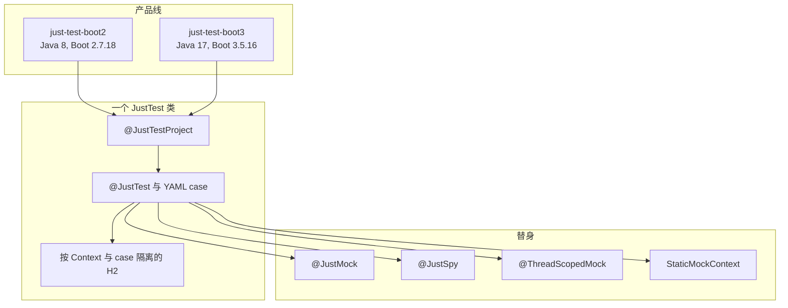
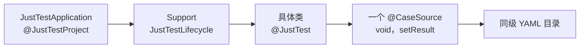
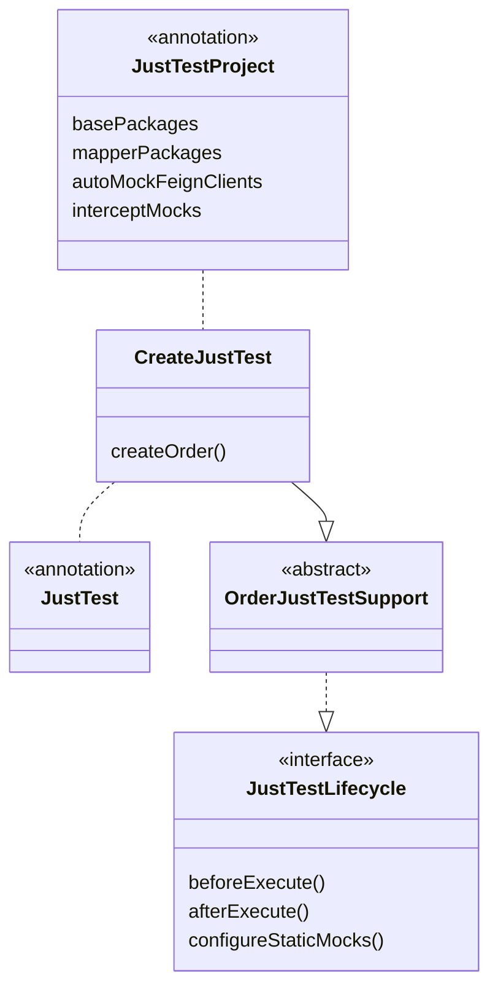
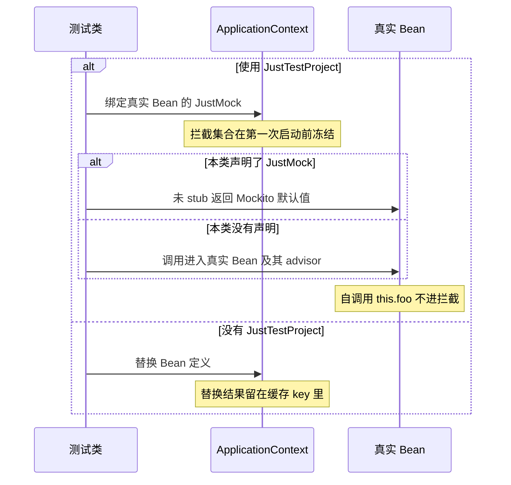
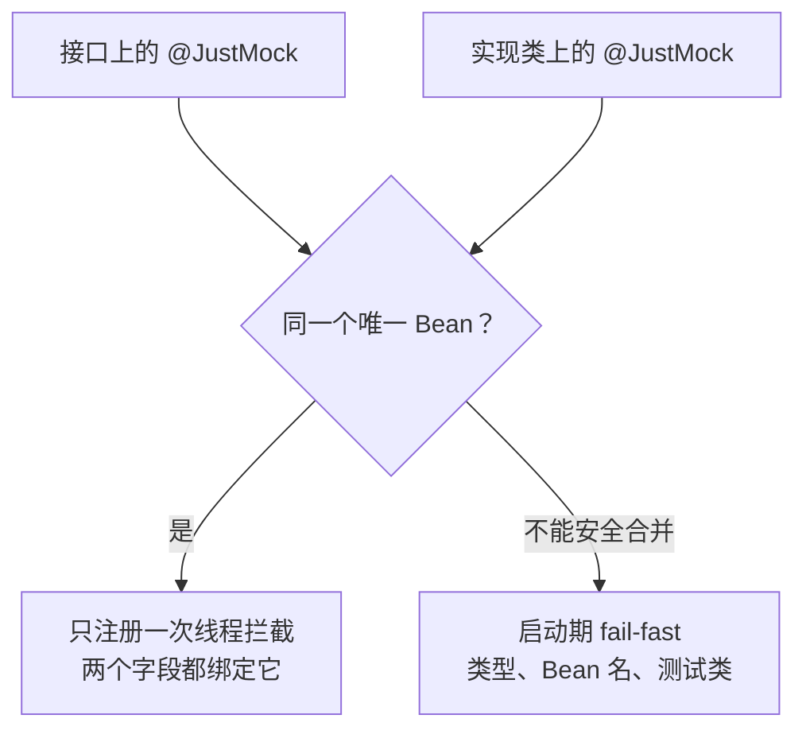
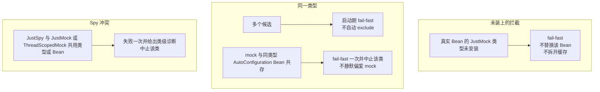
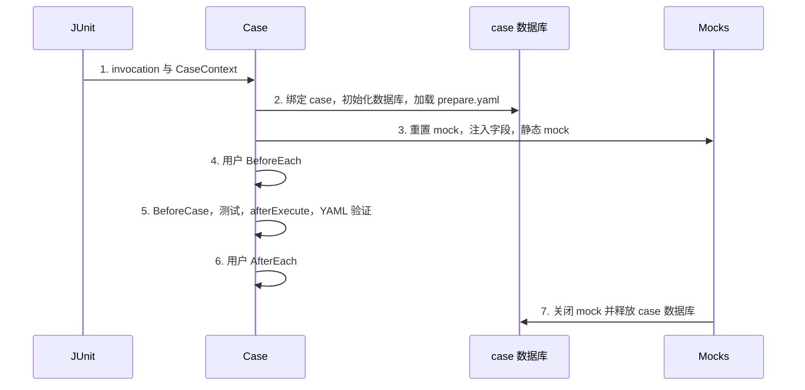
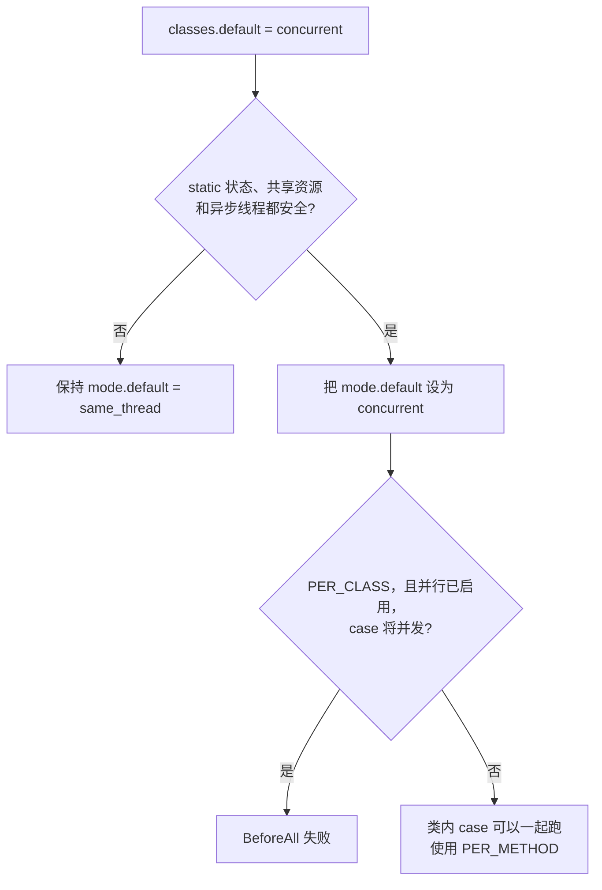

# just-test

[English](README.md)

`just-test` 是可复用的 Java 测试工具库，采用 [Apache License 2.0](LICENSE)。

- 两条产品线、同一套公开 API：Spring Boot 2 与 Spring Boot 3 共用 `com.just.test` 和核心语义。
- 只覆盖测试范围：可重复的准备、断言与替身。
- 不替代业务架构、生产数据库兼容性验证，或业务代码的并发治理。

采用顺序：[坐标](#coordinates)、[编写测试](#write-a-test)，启动或 mock 与示例不一致时再看[规则](#rules)。

<a id="coordinates"></a>

## 坐标

Maven Central 的 group 为 `io.github.cyaquarius`。当前已发布版本为 `1.2.9`。

| | Boot 2 | Boot 3 |
| --- | --- | --- |
| `artifactId` | `just-test-boot2` | `just-test-boot3` |
| Java / Spring Boot | 8 / 2.7.18 | 17 / 3.5.16 |
| Java 包名 | `com.just.test` | `com.just.test` |
| 已发布版本 | `1.2.9` | `1.2.9` |
| 待发布 / 本地安装 | `1.2.10` | `1.2.10` |

Java 8 / Boot 2：

```xml
<dependency>
    <groupId>io.github.cyaquarius</groupId>
    <artifactId>just-test-boot2</artifactId>
    <version>1.2.9</version>
    <scope>test</scope>
</dependency>
```

- Java 17 / Boot 3：把 `artifactId` 换成 `just-test-boot3`。不要同时引入两个顶层 artifact。
- 不要单独声明 `just-test-core`。它已打进 boot JAR，没有独立的 Central 坐标。
- Central **只发布** `just-test-boot2` 与 `just-test-boot3`。
- 公司私服已代理 Central 时，只需上面的依赖声明。
- 环境访问不了 Central 时，可代理 Central，或把 boot2 / boot3 制品上传到私服 release 仓库，并保持 group 为 `io.github.cyaquarius`。
- 基于本仓库开发仍用本地 `mvn install`，装到的是待发布的 `1.2.10`。版本记录见[变更记录](#changelog)。依赖基线见[兼容性](#compatibility)。

<a id="capabilities"></a>

## 能力



- [`@JustTest`](#justtest)：在框架提供的 H2、JDBC 与事务上跑 Boot 测试类。
- [`@JustTestProject`](#justtestproject)：消费方启动注解。
- [`@CaseSource`](#casesource)：每个 YAML case 一次 JUnit invocation。文件：`prepare.yaml`、`response.yaml`、`expect.yaml`、`expect_exception.yaml`。
- [`@JustMock`](#justmock)、[`@JustSpy`](#justspy)、[`@ThreadScopedMock`](#threadscoped)：线程作用域替身。
- [`StaticMockContext`](#static-mocks)：在当前 case 线程替换静态 Context 或工厂入口。
- [H2](#h2) 按 case 隔离数据库。[SQL 改写](#sql-rewrite) 只覆盖一小段 MyBatis 的 MySQL→H2 桥。

<a id="write-a-test"></a>

## 编写测试

AI 编写配方：[docs/ai-justtest-authoring.md](docs/ai-justtest-authoring.md)。采用方可把 [docs/skills/just-test/SKILL.md](docs/skills/just-test/SKILL.md) 复制到自己项目的 `.cursor/skills/just-test/SKILL.md`（或对应的 agent skill 目录）。





<a id="startup-class"></a>

### 启动类

```java
// src/test/java/com/example/justtest/JustTestApplication.java
@JustTestProject(
    basePackages = "com.example",
    mapperPackages = "com.example.mapper", // 可选；没有 MyBatis 时省略
    dataSourceAliases = "masterDataSource", // 可选的存量 Bean 名
    transactionManagerAliases = "masterDataTransactionManager"
    // autoMockFeignClients = true // 按需：只自动 mock @FeignClient 接口
    // autoMockFeignClientExcludes = { BillingClient.class }
)
public class JustTestApplication {
}
```

- `JustTestApplication` 是消费工程专用于 JustTest 的启动配置，不需要 `main` 方法。类体可以为空。
- 放在独立测试包，所有 JustTest 类放在该包或其子包，例如 `com.example.justtest.order`。
- Spring Boot 会先发现这个更近的测试配置，不会继续搜索父包里的生产 `Application`。
- 只放在 `src/test` 并不能避免冲突：测试 classpath 同时包含生产类和测试类。
- 非 JustTest 的普通 JUnit 测试放在该树之外。
- 手写 `@SpringBootConfiguration` + `@EnableAutoConfiguration` + `@ComponentScan` 启动类仍然有效。新项目优先使用 `@JustTestProject`。
- 扫描排除、OkHttp、Feign 自动 mock、别名、拦截成员：见 [`@JustTestProject`](#justtestproject) 与 [`@JustMock`](#justmock)。

<a id="test-class"></a>

### 测试类与 case 方法

```java
// src/test/java/com/example/justtest/order/OrderJustTestSupport.java
abstract class OrderJustTestSupport implements JustTestLifecycle {

    @Autowired
    protected OrderService orderService;

    @JustMock
    protected PricingClient pricingClient;
}

// src/test/java/com/example/justtest/order/create/CreateJustTest.java
@JustTest
class CreateJustTest extends OrderJustTestSupport {

    @CaseSource
    void createOrder(CaseContext context) {
        context.setResult(orderService.create(context.getLong("customerId")));
    }
}
```

- 框架不采集 `@CaseSource` 方法的 Java 返回值。方法本身是 `void`。
- `response.yaml` 或 `verifyResult` 要看到结果时，必须调用 `context.setResult(...)`。漏写则按 `null` 断言。
- `@JustTest` 已包含 Spring Boot bootstrapper，并通过 `test` profile 加载 `application-test.yml`。
- 不要再组合 `@SpringBootTest`，也不要另声明 `@BootstrapWith`。
- 独立测试包内应只有一个可发现的 `@SpringBootConfiguration`。
- 测试类不在该包树下、存在多个候选启动配置，或某个测试需要特殊配置时，再用 `@ContextConfiguration(classes = JustTestApplication.class)`。
- 同类型有多个候选 Bean 时，使用 `@JustMock(name = "beanName")` 或 `@Qualifier("beanName")`。候选规则见 [`@JustMock`](#justmock)。
- 替换 Spring Bean 时优先使用 `@JustMock`，不要求使用 `@MockBean`。
- 不要用 `ReflectionTestUtils` 把 raw Mockito mock 写进业务 Bean 字段，替换 `@JustMock` 的 `ThreadScope` proxy。只 stub 测试类上的 `@JustMock` 字段。细节见[反模式](#antipatterns)。
- 只 stub 个别方法、其余走真实 Bean（包括 `prepare.yaml`）时用 `@JustSpy`。Stub 方式、自调用与 AOP 见 [`@JustSpy`](#justspy)。

<a id="static-gateways"></a>

### 静态入口

按 case 绑定静态 Spring 入口：

```java
@Override
public void configureStaticMocks(CaseContext context, StaticMockContext mocks) {
    MockedStatic<SpringContextHolder> holder = mocks.mockStatic(SpringContextHolder.class);
    holder.when(SpringContextHolder::getApplicationContext)
          .thenReturn(mocks.getApplicationContext());
}
```

- 未 stub 的静态方法继续调用真实实现。
- 不要手工关闭返回的 `MockedStatic`。JustTest 在用户 `@AfterEach` 之后，于原 case 线程关闭全部注册。
- Boot 2 使用 Mockito 4。静态 Mock 或 final 类型 Mock 需要 inline mock maker：在 `src/test/resources/mockito-extensions/org.mockito.plugins.MockMaker` 写入 `mock-maker-inline`，或引入版本一致的 `mockito-inline`。
- Boot 3 使用 Mockito 5，默认 mock maker 已是 inline。消费工程若覆盖了 MockMaker，仍需自行保证静态 / final Mock。
- JustTest 不会全局指定 MockMaker。

<a id="case-directories"></a>

### case 目录

- 默认 case 根是测试类所在包。case 目录是 classpath 上 `.java` 的同级兄弟：`{packagePath}/*/*.yaml|yml`。
- 框架不会探测 `{packagePath}/{SimpleClassName}/`。
- 同一包内最多一个**自身直接标注** `@JustTest` 的具体类。仅从父类继承 marker 不能准入。
- 抽象 Support 放在父级业务类目录，只放共享生命周期和 mock。不要标 `@JustTest`，也不要放 case YAML。抽象类上标 `@JustTest` 会 fail-fast。
- 一个具体类只放一个 `@CaseSource` 方法。同一类上多个 `@CaseSource` 会共享本包全部 sibling case。
- 用例目录仍是 Support + 方法包。不要另造一套 case 根约定。
- `@CaseSource("custom-root")` 解析为 `{packagePath}/{custom-root}/`。本包根或自定义根缺失时，以 `No YAML case directories found` 失败，并说明期望的 sibling 布局。不会静默回退到类名目录或其他根。

```text
src/test/java/com/example/justtest/order/
├── OrderJustTestSupport.java
├── create/
│   ├── CreateJustTest.java
│   ├── ok/
│   ├── dup/
│   └── bad-input/
└── cancel/
    ├── CancelJustTest.java
    └── ok/
```

每个 case 目录按需要放 `request.yaml`、`prepare.yaml`、`response.yaml`、`expect.yaml`、`expect_exception.yaml`。同一阶段也可以用 `.yml`。同一阶段两种后缀同时存在时，JustTest 会 fail-fast，并在错误里写出两个路径。用例 YAML 里的重复 key 在解析时失败。

把这些 YAML 映射进测试 classpath：

```xml
<testResources>
    <testResource>
        <directory>src/test/java</directory>
        <includes>
            <include>**/*.yaml</include>
            <include>**/*.yml</include>
        </includes>
    </testResource>
    <testResource>
        <directory>src/test/resources</directory>
    </testResource>
</testResources>
```

- `src/test/resources` 留给 `schema.sql` 和 `application-test.yml`。
- YAML 也可以按同一包路径放在 `src/test/resources`。发现路径不变。
- Flag 含义见 [YAML 文件与 Flag](#yaml)。

<a id="rules"></a>

## 规则

<a id="justtest"></a>

### `@JustTest`

- 配置 Spring Test、H2、`JdbcTemplate` 与事务管理器，被测服务可以按正常事务行为执行。
- 不存在 `refresh` scope 时注册一个替代实现，使 `@RefreshScope` 或 `@Scope("refresh")` 的 Bean 无需 Spring Cloud refresh 基础设施即可加载。
- 测试不提供真实的 refresh 语义。
- 类级执行契约见[生命周期](#lifecycle)。

<a id="justtestproject"></a>

### `@JustTestProject`

推荐的消费方启动注解。空类即可。

- `@JustTestProject` 元注解组合 `@SpringBootConfiguration` 与 `@EnableAutoConfiguration`。

**框架拥有**

- H2、事务管理器、`JdbcTemplate`。
- 默认组件扫描 denylist。**不**排除 `FeignAutoConfiguration` / `FeignContext`。
- 声明了 `mapperPackages` 时：MyBatis `SqlSessionFactory`、`SqlSessionTemplate`、MapperScan，绑定 JustTest 的 DataSource。
- 框架不选择 Feign HTTP 客户端。
- 框架不自动 mock Redis、对象存储、SDK 或其他非 Feign Bean。

**默认可覆盖**

- `excludeClasses`、`excludeFilters`、`includeFilters`、`excludeAutoConfiguration`、`autoMockFeignClients`、`autoMockFeignClientExcludes`。
- 不必复制默认 denylist。
- `enableFeignOkHttp` 已弃用，保留仅为源码兼容，不再写入任何属性。

**项目必须声明**

- `basePackages`。框架不猜测业务根包。
- `src/test/resources/sql/schema.sql`。
- 非 Feign 外部依赖的显式 `@JustMock` 或 `@ThreadScopedMock`。
- 不要把生产 DataSource 或事务管理器配置放到测试启动类上。

**扫描排除**

- `basePackages` 下的其他 `@SpringBootApplication` / `@SpringBootConfiguration`。
- 注解存在时的 `@Controller`、`@RestController`、`@ControllerAdvice`。
- classpath 上有 OpenFeign 时的 `@FeignClient`。
- 能在不引入硬依赖的前提下探测到的 Job / 调度刻板类型。

**传输层与 Feign**

- OkHttp / Feign 传输层由项目决定。JustTest 不会写入 `feign.okhttp.enabled` 或 `spring.cloud.openfeign.okhttp.enabled`，包括值为 `false`。
- 若 `OkHttpFeignConfiguration` 注册了名为 `client` 的 Bean，与 `@Resource private XxxClient client` 冲突，请在项目中关闭 OkHttp，或重命名字段，或使用 `@Resource(name = ...)`。
- `FeignAutoConfiguration` 与 `FeignContext` 仍会装配。
- `autoMockFeignClients` 默认为 `false`。
- 设为 `true` 时，只发现带 `@FeignClient` 的接口（按注解存在，不按 `*Client` 名字），并注册与 `@JustMock` 相同的线程作用域 Mockito mock。
- 同一类型上显式 `@JustMock` / `@JustSpy` / `@ThreadScopedMock` 优先于自动 mock。`@JustSpy` 包裹已有 Bean，而不是把它换成纯 mock。
- `autoMockFeignClientExcludes` 跳过选定的 Feign 类型。
- Redis、OSS、SDK 和其他 Client 仍在 Support 或 MockConfig 上显式 mock。

**别名与 MyBatis**

- 名称未被占用时，`dataSource` 与 `transactionManager` 注册为 JustTest 主 Bean 的别名。
- `dataSourceAliases` / `transactionManagerAliases` 按同样规则，为存量 `@Qualifier` / `@Transactional` 注册额外别名。
- 空白别名忽略，重复项去重。
- 目标名已有 Bean 定义或别名时不覆盖，并打出跳过日志。
- 声明了 `mapperPackages` 但缺少 mybatis-spring 会 fail-fast。
- 有 mybatis-spring 但未声明 `mapperPackages` 时，不会猜测扫描根。

**迁入手写启动类**

- 手写启动类仍然可用。
- 从较窄的手写启动类迁到 `@JustTestProject` 会扩大组件扫描和 Boot 自动配置。把项目自己的 `excludeAutoConfiguration` 与 mock 一并迁过去。
- JustTest 不会为了让 mock 胜出而自动 exclude 第三方 `*AutoConfiguration`。冲突行为见 [`@ThreadScopedMock` 与自动配置](#threadscoped)。

<a id="casesource"></a>

### `@CaseSource`

- 发现 YAML 用例，并为每个 case 创建一次完整的 JUnit test-template invocation。
- 测试方法与标准单测生命周期方法都可以使用 `CaseContext`。
- `@CaseSource` 本身就是测试注解。不要再与其他 JUnit 测试注解组合。
- 目录规则见 [case 目录](#case-directories)。步骤见[生命周期](#lifecycle)。

<a id="justmock"></a>

### `@JustMock`



**线程作用域 mock**

- `@JustMock` 创建线程作用域 Mockito mock。
- Spring 自动代理不会再包裹这个线程实例。被替换的具体类即使带 `@Repository` 这类会被自动代理的注解，注入字段仍然是可 stub 的 Mockito mock。

**选择 Bean**

- 同类型多 Bean 时，显式 `name` 只命中类型兼容的 Bean。
- 现有 Bean 类型无法解析时（例如 `FactoryBean` 隐藏了对象类型），仍使用名称回退。
- 名称相同但类型无关的 Bean 不会被替换。
- 错误的显式名称以缺少候选 Bean 失败。
- 同一类型有多个候选时，仍在启动期 fail-fast。
- 不会自动 exclude `*AutoConfiguration`。

**绑定已有的线程级 mock**

- 解析到的目标已经是线程级 mock 时（`@ThreadScopedMock` 的 `@Bean`，或 `@JustTestProject(autoMockFeignClients = true)` 创建的 Feign mock），字段只做绑定。
- 不再注册一份 Bean 定义。
- 这条声明不进入 Spring Test 上下文缓存 key。
- 对不同子集做绑定的测试类共享同一个 `ApplicationContext`。
- 注入时解开 scoped proxy，因此 `when(field...)` 和 `doReturn(...).when(field)` 直接打在字段上。
- 每个 case 的重置不变。

**真实 Bean，且使用 `@JustTestProject`**

- 指向真实 Bean 的 `@JustMock` 同样只绑定。
- 启动时真实 Bean 被藏起来，advisor 留在真实 Bean 上。
- 公开 Bean 是按线程切换默认答案的 Mockito mock。
- 当前测试类声明了该类型的 `@JustMock` 时，未 stub 返回 Mockito 默认值；没声明的测试类仍走真实 Bean。
- 激活看的是声明，不是当前有没有 stub。
- case 结束重置 stub。
- 这条声明不进入缓存 key，因此真实 Bean 字段子集不同的测试类共用一个 Context。
- 拦截类型在该共享 Context 第一次启动前确定，之后不能再增加。
- 集合由该 `@JustTestProject` 的 `interceptMocks`，加上该启动类所在包及其子包里、解析出的启动类就是这个 `@JustTestProject` 类的 `@JustTest` 上的真实 Bean `@JustMock` 组成。
- 包树之外的测试若需要拦截，必须把类型写进 `interceptMocks`。
- 之后再对未装上的类型使用 `@JustMock` 会 fail-fast。不会退回替换该 Bean，也不会拆开缓存。
- 真实 Bean 内部的 `this.foo()` 自调用不会进拦截。

**同一个 Bean 的接口与实现（`1.2.8`）**



- `1.2.7` 仍然拦截真实 Bean，也仍然共用一个 Context。该版本按声明类型注册拦截。
- `1.2.8` 按解析到的 Bean 名注册，一个 Bean 名只注册一次。
- 接口声明和实现类声明解析到这同一个唯一 Bean 时，共用这一次拦截。两个 `@JustMock` 字段都绑定它。
- 当前测试类声明了其中任一类型，未 stub 走 Mockito 默认值。两个类型都没声明的类仍调用真实 Bean。
- 第二次声明无法安全合并时（mock 类型不兼容，或命中多个 Bean），Context 启动即失败。
- 失败信息列出冲突的声明类型、Bean 名，以及声明它们的测试类。
- 解析到同一个 Bean 的接口 / 实现混用仍然合法，不要求改写这些声明。

**真实 Bean，且没有 `@JustTestProject`**

- 真实 Bean 仍会替换定义。
- 该替换仍参与缓存 key。



- 命中任意一条即启动失败。图只是把这些检查放在一起，不是执行顺序。自动配置冲突的诊断见 [`@ThreadScopedMock` 与自动配置](#threadscoped)。

<a id="justspy"></a>

### `@JustSpy`

- 对已有 Bean 做部分 stub。未 stub 的方法走真实 Bean，`prepare.yaml` / H2 数据仍然生效。
- Bean 选择规则与 `@JustMock` 相同（`name` / `@Qualifier` / 候选）。
- 找不到 Bean 时启动失败。不会自动创建。
- 真实 Bean 被藏成非注入候选的 singleton，不会变成同类型的第二个可注入 Bean。
- 原 Bean 名变成线程作用域 ScopedProxy。每个线程的实例是 `mock(type, withSettings().defaultAnswer(delegatesTo(realBean)))`。
- 因此 MyBatis `MapperFactoryBean` 和 Feign 风格的 JDK 代理不需要 `Mockito.spy`。
- 委托目标是容器里 Spring 暴露的那个 Bean。
- 若它是 `@Transactional` 等 AOP 代理，未 stub 的调用仍走代理及其 advisor，不会拆到 target。
- 线程作用域 mock 不会被自动代理再次包裹，因此 `@Repository` 的异常转换和 `@Transactional` 留在真实 Bean 上。
- 测试字段可以直接 `doReturn` / `doThrow`。
- Stub 用 `doReturn`、`doThrow` 或 `doNothing`。`when(spy.foo())` 会调用真实方法。
- 真实 Bean 内部的 `this.bar()` 不会被拦截。
- 显式 `@JustSpy` 优先于 `autoMockFeignClients`。
- 同一字段不能同时标注 `@JustMock` 与 `@JustSpy`。
- 同一类型，或解析到同一个 Bean 时，不能再被 `@JustMock` 或 `@ThreadScopedMock` 替换。启动期只失败一次，并给出类级诊断（类型、候选、来源），JUnit 中止该类。
- `@JustSpy` 仍进入 Spring Test Context 缓存 key。真实 Bean `@JustMock` 拦截不改变这一点。
- 每个 case 重置后会新建委托 mock，stub 不会泄漏到下一个 case。

<a id="threadscoped"></a>

### `@ThreadScopedMock` 与自动配置

- `@ThreadScopedMock` 把同一套 scoped mock 用在标注的 `@Bean` 方法上。
- 若 `@JustMock` 或 `@ThreadScopedMock` 仍与某个 `*AutoConfiguration` 的同类型 Bean 共存，JustTest 在 Context 启动时 fail-fast 一次。
- 诊断包含冲突类型、候选 Bean 名、mock 与自动配置来源，以及下一步：`excludeAutoConfiguration` 或删掉多余 mock。
- 不会自动 exclude 自动配置，不会静默让 mock 胜出，也不会改 `@Resource` 匹配。
- JUnit 中止该测试类，避免每个 YAML `@CaseSource` case 都重新加载同一个失败 Context。

<a id="static-mocks"></a>

### `StaticMockContext`

- 可在当前 case 线程替换业务静态 Context 或工厂入口，并在 case 结束时恢复。
- 生效窗口、异步线程与旧测试见[边界](#boundaries)。

<a id="h2"></a>

### H2

- JustTest Context 使用框架提供的 H2 `DataSource`、事务管理器和 `JdbcTemplate`。
- 其余生产持久化配置用 `test` profile 或 `excludeClasses` / `excludeFilters` 排除。
- 框架不会改写用户 Bean 的 `@Primary`。
- 框架不会替消费方在生产数据源和测试数据源之间做选择。
- H2 按 JustTest `ApplicationContext` 与活动 case 隔离。
- 清理后的 DDL 会缓存。默认从模板数据库克隆 schema。用 `justtest.schema.clone=false` 关闭克隆。
- case 结束时释放对应数据库。schema 初始化失败会重试。
- 对于 MySQL 的 `schema.sql` dump，清理器会剥离常见的 `SHOW CREATE TABLE` 附加语法：表级 `ROW_FORMAT`、`UNSIGNED`、`ON UPDATE CURRENT_TIMESTAMP`、列级 `CHARACTER SET`、`DEFAULT b'0'`。
- 不覆盖全部 MySQL 方言。
- `@JustTest` 拥有 H2 时，框架 `JdbcTemplate` 或 `JustTestRoutingDataSource` 缺失是配置错误，会 fail-fast，而不会跳过 prepare / verify。见[边界](#boundaries)。

<a id="sql-rewrite"></a>

### MySQL 到 H2 的改写

- MyBatis 测试 SQL 只做窄改写：`IF(...)` 改为 `CASEWHEN(...)`，`DATE_FORMAT(...)` 改为 `FORMATDATETIME(...)`。
- `DATE_FORMAT` 改写走 MyBatis `StatementHandler` 拦截器，与 `IF(...)` 到 `CASEWHEN(...)` 同一条路径。
- 纯 `JdbcTemplate` SQL 若不经过该拦截器，则不会改写。
- 历史双引号字符串只在已知字符串函数参数，以及比较运算符右值中兼容。
- 新 SQL 应使用标准单引号。该限制同时写在[边界](#boundaries)。

<a id="yaml"></a>

## YAML 文件与 Flag

- `request.yaml`：通过 `CaseContext` 的 `getString`、`getLong`、`getInt`、`getObject`、`getList`、`getMap` 读取输入。
- `prepare.yaml`：case 执行前插入的行。
- `response.yaml`：预期返回值。只与 `CaseContext.setResult` 写入的对象比较，不读取测试方法的 Java 返回值。
- `expect.yaml`：预期数据库行。
- `expect_exception.yaml`：预期异常类型及可选消息。文件存在但为空，或没有 `type`，是配置错误，不会把任意异常当成预期异常。

字段后缀 Flag 按阶段生效：

- `[C]` 用于 `expect.yaml` 的行定位，以及 `response.yaml` 的 List 无序匹配。
- List 中只要出现 `[C]`，每个预期元素都必须是对象，且至少有一个 `[C]` 字段。
- 混合有定位键和无定位键的无序预期会被拒绝。
- `[CN]` 只用于 `expect.yaml`。
- `[F]` 只用于 `prepare.yaml`。
- 其余 Flag 按下表用于对应的准备或断言阶段。

| Flag | 含义 |
| --- | --- |
| `[C]` | 行定位键；同时启用 List 无序匹配。 |
| `[CN]` | 定位的行必须不存在。 |
| `[N]` | 跳过字段；在 `prepare.yaml` 中表示不插入该列。 |
| `[R]` | 正则匹配。 |
| `[A]` | 非空断言。 |
| `[D]` / `[D60]` | 实际时间落在距*当前时刻* N 秒内（默认 60 秒）。YAML 中的期望值不参与比较。 |
| `[J]` | JSON 结构比较。 |
| `[F]` | `prepare.yaml` 中的原始数据库函数，如 `NOW()`。 |

Flag 区分大小写。未知 Flag（如 `[cn]`、`[CC]`）或用在不适用阶段的 Flag 会立即失败。错误信息包含字段名、case 路径，以及该阶段允许的 Flag。

数据库断言建议显式提供 `[C]` 字段，避免行定位含义不明确。`[C]` 命中多行时失败，需要收紧条件直到只命中一行。`[J]` 比较 JSON 结构；数值按 BigDecimal 比较，所以 `1` 与 `1.0` 相等，无法解析的 JSON 会报错。

<a id="lifecycle"></a>

## 生命周期



- `@JustTest` 是测试类级执行契约：测试类必须实现 `JustTestLifecycle`，类内所有可执行测试方法都必须使用 `@CaseSource`。
- 类未实现该接口，或类中存在 `@Test`、`@RepeatedTest`、`@ParameterizedTest`、`@TestFactory` 或其他普通 JUnit 测试方法时，JustTest 在 `BeforeAll` 失败并提示修正。
- `@TestInstance(PER_CLASS)` 与类内并发 case 组合（仅当 `junit.jupiter.execution.parallel.enabled=true`）也会在 `BeforeAll` 失败。见[并行](#parallel)。
- 渐进迁移时保留原有 JUnit 测试类，把新 case 放入独立的 `@JustTest` 类。未标注 `@JustTest` 的旧测试类不受影响。
- `@CaseSource` 本身就是测试注解。不要再与其他 JUnit 测试注解组合。

每个 YAML case 依次执行：

1. 创建独立的 JUnit invocation 及其 `CaseContext`；
2. 绑定 case，创建并初始化全新的 case 数据库，然后加载 `prepare.yaml`；
3. 重置、预热 scoped mock，注入 `@JustMock` / `@JustSpy` 字段并配置 case 静态 Mock；
4. 执行用户的 `@BeforeEach`；
5. 调用匹配的 `@BeforeCase("case-name")` 与 `beforeExecute`，执行测试方法；无论测试方法返回还是抛出，都调用 `afterExecute`，再进行异常、返回值和数据库验证。若 `afterExecute` 自身抛出，则跳过 YAML 验证并直接抛出该异常（若测试方法也抛过异常，会作为 suppressed 附加）。无 `expect_exception.yaml` 且 `verifyException` 未处理的异常会在 `afterExecute` 与 YAML 验证之后重新抛出；
6. 执行用户的 `@AfterEach`；
7. 关闭静态与 scoped mock，释放 case 数据库；清理失败不会掩盖原始测试失败。

<a id="compatibility"></a>

## 兼容性

| 组件 | `just-test-boot2` | `just-test-boot3` |
| --- | --- | --- |
| Java | 8 | 17 |
| Spring Boot | 2.7.18 | 3.5.16 |
| Spring Framework | 5.3.31 | 6.2.19 |
| JUnit Jupiter | 5.14.4 | 5.12.2 |
| Mockito | 4.11.0 | 5.17.0 |
| MyBatis / mybatis-spring | 3.5.19 / 2.1.2 | 3.5.19 / 3.0.6 |
| H2 | 2.1.214 | 2.3.232 |
| SnakeYAML | 1.33 | 2.4 |
| fastjson2 | 2.0.64 | 2.0.64 |
| SLF4J | 1.7.36 | 2.0.18 |

- Boot 2 线保留最后一个正式版本 2.7.18，以及真实的 Java 8 基线。
- Boot 3 线使用仍属 Boot 3、基于 Java 17 的稳定版本 3.5.16，不升级到 Boot 4。
- 除 MyBatis、mybatis-spring、fastjson2、Boot 2 的 Mockito / SnakeYAML、Boot 2 的 `junit-bom` 覆盖（JUnit Jupiter 5.14.4）和构建插件外，版本由对应 Spring Boot BOM 管理。
- 构建使用 Maven Compiler Plugin 3.15.0 和 Surefire 3.5.6。
- CI 使用 `actions/checkout@v7` 与 `actions/setup-java@v6`。
- 上表是两条产品线独立构建和验证时的基线。
- CI 还会在匹配的 Spring Boot parent / BOM 下跑消费烟测，覆盖常见业务工程结构。

<a id="boundaries"></a>

## 边界与并发

JustTest 只隔离自己拥有的测试资源。它**不能**让任意业务代码天然全局并发安全。

- 业务代码初始化的 static registry 仍由业务侧负责。
- case 静态 Mock 只作用于当前线程，在用户 `@BeforeEach`、测试方法和用户 `@AfterEach` 中持续生效；它不能覆盖 Spring Context refresh 或早于 case invocation 的 Spring Test listener，也不会传播到业务自行创建的异步线程。
- 检测到多个 Spring Context 时，JustTest 会输出一次风险警告；相关 case 失败时会追加诊断日志，但不会替换原始异常。任意静态 Mock 的存在不会抑制该提示，因为框架无法判断它是否覆盖了相关入口。
- 新旧测试类可以并存；未标注 `@JustTest` 的旧测试不会启用 JustTest 生命周期。但如果新旧测试并行执行，并且业务代码共享 JVM static ContextHolder / 工厂，JustTest 无法保护旧测试线程；应让受影响的旧测试保持串行，或迁移其静态入口。
- 手工线程、`CompletableFuture` common pool 和未由 JustTest 接管的 executor，不会自动获得 mock 或数据库上下文；没有活动 case 的数据库或 thread-scoped mock 访问会立即失败，而不会静默创建空 H2 或未配置的 mock。`@JustTest` 拥有 H2 基础设施时，若框架 `JdbcTemplate` 或 `JustTestRoutingDataSource` 缺失，同样视为配置错误并立即失败，而不会跳过 prepare / verify。
- 测试类或 `@CaseSource` 方法上的 Spring `@Transactional` 与 `@Sql` 不受支持：它们的生命周期早于 case 绑定，框架会在执行前报错。请使用 `prepare.yaml` 和 `expect.yaml` 管理确定性的 case 数据。
- 重跑成功不能证明并发安全。存在 Flake 的测试应保持串行，直到其所有权和生命周期边界清晰。
- 新 SQL 应使用标准单引号字符串；双引号改写仅是兼容历史 MySQL Mapper 的过渡能力。

<a id="parallel"></a>

### 并行

并行调度由消费工程的 JUnit 配置控制。测试并行之后，JustTest 隔离自己拥有的框架资源。



先让测试类并行，同一类中的 case 保持串行：

```properties
# src/test/resources/junit-platform.properties
junit.jupiter.execution.parallel.enabled=true
junit.jupiter.execution.parallel.mode.default=same_thread
junit.jupiter.execution.parallel.mode.classes.default=concurrent
```

- 业务 static 状态、外部共享资源和异步线程都确认安全后，把 `mode.default` 改为 `concurrent`，允许同一测试类中的 case 并行。
- 正常测试类不需要声明 `@Execution`。只有个别类无法满足并发边界时，用 `@Execution(ExecutionMode.SAME_THREAD)` 局部降级。
- `@TestInstance(PER_CLASS)` 不能与类内并发 case 组合：仅当 JUnit 并行已启用（`junit.jupiter.execution.parallel.enabled=true`），且 case 会并发执行（`@Execution(CONCURRENT)` 或 `mode.default=concurrent`）。
- 这些 case 会共享一个测试实例，并可能竞态 `@JustMock` 字段注入。
- 若并行未启用，残留的 `@Execution` 或 `mode.default=concurrent` 不触发该检查。
- 并发 case 使用 JUnit 默认的 `PER_METHOD`；需要 `PER_CLASS` 时保持 `SAME_THREAD`。
- 类间并行（`mode.classes.default`）不等于类内 case 并发。
- 需要 N 方同时到达的重叠或屏障契约，也必须从同一个线程池拿到 N 个空闲 worker。
- 本仓库的契约测试在 `src/contract-test/resources/junit-platform.properties` 里把并行池固定为 2（`junit.jupiter.execution.parallel.config.strategy=fixed`，`junit.jupiter.execution.parallel.config.fixed.parallelism=2`）。
- 2 方屏障会占住一个 worker，直到另一方进入。若这些参与方与默认套件里的其他并发类共享这个池，一个 worker 可能停在别的类里，缺的一方不会被调度，屏障就会超时。
- 这是固定池被占满时的 JUnit 调度问题。JustTest 的隔离不变：消费方仍可让测试类并行，并在上面的安全确认之后让同一类中的 case 并行。
- 拆分 Surefire 只是为了把池里的两个 worker 留给屏障。
- 本仓库的 `just-test-boot2` 与 `just-test-boot3` 每次 Surefire 执行都使用这份 properties。
- `ConcurrentCasesJustTest`（类内 case 重叠）跑在 `concurrent-case-contract`。
- `ParallelFirstJustTest` 与 `ParallelSecondJustTest`（类间重叠）跑在 `parallel-class-contract`。
- `default-test` 仍并发运行其余契约类。
- 这些重叠类留在各自的 execution。放回 `default-test`、把 case 改成串行、放宽重叠断言，或只加大屏障超时，都解决不了同一处调度停滞。

<a id="antipatterns"></a>

### 并行落地反模式

并行失败不一定是 JustTest 隔离失效；先排查下游项目的替身、静态状态和资源生命周期。以下用法会把使用错误伪装成 framework flake：

1. **用 `ReflectionTestUtils` 覆盖 `@JustMock` 代理**
   - **错误：** 在 `beforeExecute` 中使用 `ReflectionTestUtils`，把 raw Mockito mock 写入业务 Bean 字段，覆盖 `@JustMock` 创建的 `ThreadScope` proxy。业务 Bean 往往是 singleton，这会污染 singleton 字段，让其他线程或 case 看到错误的 stub。
   - **正确：** 只 stub 测试类上的 `@JustMock` 字段，让业务 Bean 保持 scoped proxy。静态工厂或 Context 入口使用 `StaticMockContext` / `configureStaticMocks` 按 case 配置。

2. **给 case H2 URL 加数据库保活参数**
   - **错误：** 为掩盖 `already closed`，在 case URL 上增加 `DB_CLOSE_DELAY=-1`（或类似的 keep-alive 参数）。这只是延后暴露生命周期问题，会造成内存增长、完整测试运行变慢甚至 OOM。
   - **正确：** 按 [#12（already closed）](https://github.com/cyAquarius/just-test/issues/12) 的资源边界处理：case 切换时先解绑线程上的 JDBC/MyBatis holder，再释放旧 DataSource 并重建当前 case 的 DataSource。模板数据库可为 schema clone 在内部使用 `DB_CLOSE_DELAY=-1`（见 [#16](https://github.com/cyAquarius/just-test/issues/16)），但这不意味着可以把它加到 case URL；默认 case URL 不含 `DB_CLOSE_DELAY`。

3. **期待 JustTest 自动修复业务 static registry**
   - **错误：** 将业务 static Context、factory 或 registry 的并发污染归咎于 JustTest，期待框架自动修复，或默认在上游加入全局 `ContextCreationLock`。JustTest 不负责这些业务静态入口的所有权和并发治理。
   - **正确：** 按落地清单排查：
     - 出现多个 Spring Context 警告时，检查 `StaticMockContext` / `configureStaticMocks` 是否覆盖相关 static Context 或 factory 入口。
     - Mapper `#0` 双 Bean 等 Bean 装配问题按名称、限定符和启动配置排查，参考 [#11](https://github.com/cyAquarius/just-test/issues/11)，不要用全局锁掩盖。
     - 无法隔离的测试保持串行：使用 `@Execution(ExecutionMode.SAME_THREAD)`，或将测试类设为串行。
     - 不要默认在上游加入全局 `ContextCreationLock`；先修正静态入口的隔离方式，无法隔离的测试就保持串行。

4. **未 stub 的外部依赖配合业务 fail-open**
   - **错误：** 关键外部依赖未 stub，业务又把异常吞掉或将异常当作成功；并行时不同返回值和时序会让它看起来像 framework flake。
   - **正确：** 在 `beforeExecute` / `@BeforeCase` 中为关键外部协作者设置明确 stub，并显式断言成功与异常路径；不要把未定义的外部返回值交给业务 fail-open 逻辑。

<a id="changelog"></a>

## 变更记录

当前 Maven Central 发布版本是 `1.2.9`。上面的规则对应该版本。

- **1.2.10（待发布）** — YAML 加载和断言的静默通过改为 fail-fast。重复 key 会被拒绝。存在但为空或缺少 `type` 的 `expect_exception.yaml` 是配置错误，不会吞掉异常。`expect.yaml` 的 `[C]` 命中多行时失败，直到收紧到唯一一行。`[J]` 把数值按 BigDecimal 比较（`1` 等于 `1.0`），JSON 解析失败会报错，不再退回字符串比较。对象内部单独的 `[N]:` 只跳过该键。[Issue #113](https://github.com/cyAquarius/just-test/issues/113)。
- **1.2.10（待发布）** — 未知或大小写错误的 YAML flag（如 `[cn]`、`[CC]`）立即失败，不再降级为精确匹配。错误信息包含字段名、case 路径和该阶段合法 flag。[Issue #108](https://github.com/cyAquarius/just-test/issues/108)。
- **1.2.10（待发布）** — 加载发现阶段已经接受的 `.yml` 用例文件。只含 `.yml` 夹具的目录会执行预置和断言。同一阶段同时存在 `.yaml` 与 `.yml` 时 fail-fast。[Issue #100](https://github.com/cyAquarius/just-test/issues/100)。

- **1.2.9** — 安装线程拦截时读取 MapperFactoryBean 产品类型元数据，不提前初始化无关 FactoryBean。[Issue #97](https://github.com/cyAquarius/just-test/issues/97)。

- **1.2.8** — 按解析到的 Bean 名只注册一次线程拦截。[Issue #93](https://github.com/cyAquarius/just-test/issues/93)。
  - 接口 `@JustMock` 与实现类 `@JustMock` 解析到同一个唯一 Bean 时只注册一次。两个字段绑定同一个线程级 mock。
  - 声明了其中任一类型即激活 Mockito 默认值。两个类型都没声明的测试类仍调用真实 Bean。
  - 无法安全合并的声明（mock 类型不兼容、多个候选 Bean）在 Context 启动时失败。
  - 诊断列出声明类型、Bean 名，以及声明它们的测试类。
  - `1.2.7` 的上下文复用拦截保留。这个版本不会改成「凡是接口/实现混用就 fail-fast」。
- **1.2.7** — 指向真实 Bean 的 `@JustMock` 改为拦截，不再替换该 Bean、拆开 Spring Test Context。[Issue #88](https://github.com/cyAquarius/just-test/issues/88)。完整规则见 [`@JustMock`](#justmock)。
  - 使用同一个 `@JustTestProject` 启动类的测试共用一个 `ApplicationContext`。
  - 拦截类型在该共享 Context 第一次启动前确定，之后不能再增加。
  - 集合为 `@JustTestProject(interceptMocks = ...)`，加上该启动类所在包及其子包里、解析出的启动类就是这个 `@JustTestProject` 类的 `@JustTest` 上声明的真实 Bean `@JustMock` 类型。
  - 包树之外的测试若需要拦截，必须把类型写进 `interceptMocks`。
  - 当前线程上，声明了 `@JustMock` 时，未 stub 返回 Mockito 默认值。
  - 没有声明该类型的测试类仍调用真实 Bean 及其 advisor。
  - case 结束重置 stub。
  - 这些声明不重复注册 Bean 定义，也不进入上下文缓存 key。
  - 没装上拦截的 `@JustMock` 会 fail-fast。不会替换该 Bean，也不会拆开缓存。
  - `@JustSpy` 保持原样，仍然进入缓存 key。
  - 真实 Bean 内部的 `this.foo()` 自调用不会进拦截。
- **1.2.6** — 已经是线程级 mock 的 `@JustMock` 视为绑定。[Issue #85](https://github.com/cyAquarius/just-test/issues/85)。
  - 目标是 `@ThreadScopedMock` 的 `@Bean`，或 `autoMockFeignClients` 创建的 Feign client。
  - 字段照常注入，并解开 scoped proxy 以便 stub。
  - 不再重复注册 Bean 定义，也不会因此新建 Spring Test Context。
  - `@JustSpy` 仍会改变上下文缓存 key。
- **1.2.5** — 具体类会被 Spring 自动代理（`@Repository`、`@Transactional`）时，线程作用域 `@JustSpy` / `@JustMock` 仍可直接 stub。advisor 留在真实 Bean 上。[Issue #81](https://github.com/cyAquarius/just-test/issues/81)。
- **1.2.4** — 新增 `@JustSpy`：只 stub 已有 Bean 的部分方法，未 stub 的方法仍走真实 Bean，包括 `prepare.yaml` / H2。
- **1.2.3** — 未结束的 Spring 事务同步或线程状态会使泄漏源 case 失败。
  - 每个 case 边界都检查，包括该 case 的 `expect_exception.yaml` 已经匹配时。
  - 业务代码必须在所有路径 commit 或 rollback，或把校验移到 `getTransaction` 之前。
  - JustTest 只在确认泄漏后隔离线程状态，使下一个 case 不受污染。该隔离不是业务 rollback 的替代品。
  - [Issue #6](https://github.com/cyAquarius/just-test/issues/6) 与 [#12](https://github.com/cyAquarius/just-test/issues/12) 处理 MyBatis / JDBC holder。[#67](https://github.com/cyAquarius/just-test/issues/67) 进一步处理 Spring 事务同步与 active-transaction 线程状态。
- **1.2.2** — `@JustMock` / `@ThreadScopedMock` 与某个 `*AutoConfiguration` 的同类型 Bean 共存时 fail-fast，给出类级诊断，而不再让每个 YAML case 重复抛出 `NoUniqueBeanDefinitionException`。框架仍然不会自动 exclude 自动配置。
- **1.2.1** — 撤回框架默认关闭 OkHttp，并增加 opt-in 的 `@JustTestProject(autoMockFeignClients)`，仅自动 mock `@FeignClient` 接口。

<a id="public-api"></a>

## 公开 API

- 稳定公开 API 位于 `com.just.test`：`annotation`（`@JustTest`、`@JustTestProject`、`@CaseSource`、`@JustMock`、`@JustSpy`、`@BeforeCase`、`@ThreadScopedMock`）、`CaseContext`、`JustTestLifecycle`、`StaticMockContext`。
- `JustTestMarker` 与 Boot 模块的 `JustTestClassValidationExtension` 只供 `@JustTest` 注册 JUnit / Spring 基础设施。不要直接依赖。
- 引擎类型在 `com.just.test.internal`。即便因 JUnit 或 Spring 注册而保持 public，也不对消费方提供兼容承诺。
- 迁移到 Boot 3 时，消费工程自己的 Java EE 类型仍需按 Spring Boot 3 的要求迁到 Jakarta。
- Java SE 的 `javax.sql.DataSource` 不属于这次 Jakarta 迁移。

<a id="build"></a>

## 构建与验证

只有 Java 8 的环境可以单独验证 Boot 2：

```bash
JAVA_HOME=/path/to/jdk8 PATH="$JAVA_HOME/bin:$PATH" \
  mvn --batch-mode --no-transfer-progress -pl just-test-boot2 -am clean install
JAVA_HOME=/path/to/jdk8 PATH="$JAVA_HOME/bin:$PATH" \
  mvn --batch-mode --no-transfer-progress -f smoke-tests/boot2/pom.xml clean test
```

Java 17 环境可以单独验证 Boot 3：

```bash
JAVA_HOME=/path/to/jdk17 PATH="$JAVA_HOME/bin:$PATH" \
  mvn --batch-mode --no-transfer-progress -pl just-test-boot3 -am clean install
JAVA_HOME=/path/to/jdk17 PATH="$JAVA_HOME/bin:$PATH" \
  mvn --batch-mode --no-transfer-progress -f smoke-tests/boot3/pom.xml clean test
```

- 两条产品线都执行同一份 `src/contract-test` 契约测试。
- 各自的第二条命令跑 `smoke-tests/` 下对应工程。
- Java 17 下的 `mvn clean install` 可以构建整个 reactor，但不能替代上面的真实 Java 8 验证。
- CI 为两个 JDK 提供独立完整 Job，并跑消费烟测。
- 仓库只包含可复用框架代码和最小演示。不要加入具体业务包、业务表结构或业务测试。
